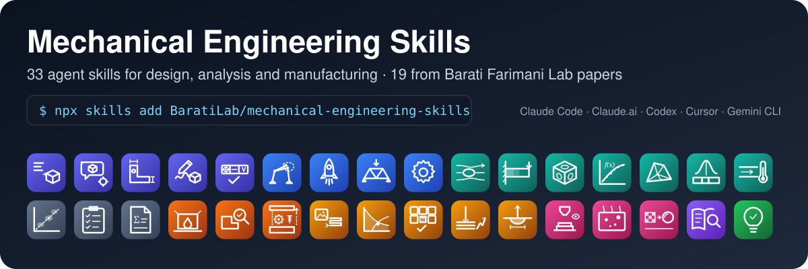
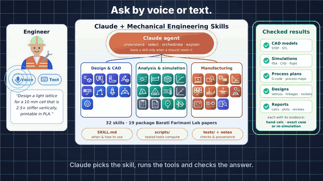
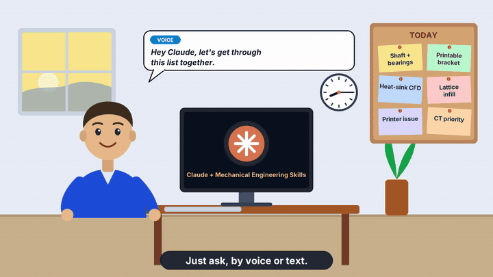
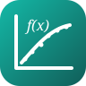
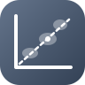

<p align="center"></p>

<table>
<tr>
<td width="50%" align="center"><a href="https://baratilab.github.io/mechanical-engineering-skills/videos.html"></a><br><b>▶ 60-second tour of the library</b></td>
<td width="50%" align="center"><a href="https://baratilab.github.io/mechanical-engineering-skills/videos.html"></a><br><b>▶ Six tasks before lunch, by voice and text</b></td>
</tr>
</table>
<p align="center"><sub>Click a preview to watch the full video with sound, or download the
<a href="docs/media/mes_launch.mp4">tour</a> and <a href="docs/media/mes_cartoon.mp4">cartoon</a> MP4s.</sub></p>

<p align="center">
<a href="https://baratilab.github.io/mechanical-engineering-skills/"><b>Tutorials & use cases</b></a> ·
<a href="https://baratilab.github.io/mechanical-engineering-skills/videos.html">Videos</a> ·
<a href="#install">Install</a> ·
<a href="#whats-inside">Full skill list</a> ·
<a href="docs/use-cases.md">Which skill do I need?</a>
</p>

**Mechanical Engineering Skills** gives an AI agent the working habits of a mechanical engineer. It
covers design, analysis and manufacturing:
- sizing a shaft;
- setting up a CFD case;
- finding a lattice for a target stiffness;
- choosing laser settings for a new alloy;
- watching a 3D print layer by layer.

Each skill is a folder with instructions the agent follows and **tested scripts that do the
numbers**. The agent orchestrates, the tools compute, and every result comes with the check that
backs it.

**19 of the 33 skills (🔬)** package peer-reviewed or preprint research from the
[Barati Farimani Lab](https://github.com/BaratiLab)
at Carnegie Mellon University. Each comes with a step-by-step tutorial that reproduces the paper's
key results. The skills work with Claude Code, Claude.ai, Cursor, Codex, Gemini CLI and any agent
that reads the open [Agent Skills](https://skills.sh) format.

### How it works
| ① Install | ② Ask by text or voice | ③ Get checked results |
|---|---|---|
| `npx skills add BaratiLab/mechanical-engineering-skills --all` | *"Find a printable lattice with E₃ = 2.5 E₁ at under 30% density"* | The agent runs the skill's scripts, checks the answer (hand calc, exact case, re-simulation) and hands you files: STEP/STL, G-code, reports, plots |

## What's inside

33 skills; 🔬 marks the 19 that package a Barati Farimani Lab paper (each with a tested workflow and a step-by-step tutorial). Not sure which one you need? See **[docs/use-cases.md](docs/use-cases.md)**, or just describe the job to your agent.

### Design & CAD

<table>
<tr><th width="96"></th><th align="left">Skill</th><th align="left">What you can ask for</th><th align="left">Paper · Tutorial</th></tr>
<tr><td></td><td><a href="skills/cadsmith-text-to-cad"><b><code>cadsmith-text-to-cad</code></b></a> 🔬</td><td>Describe a part in words; get a CadQuery model checked by exact geometry measurements and a three-view review, exported as STEP/STL.</td><td><a href="https://arxiv.org/abs/2603.26512">CADSmith</a> · <a href="docs/tutorials/cadsmith-text-to-cad.md">tutorial</a></td></tr>
<tr><td></td><td><a href="skills/query2cad-freecad"><b><code>query2cad-freecad</code></b></a> 🔬</td><td>Plain-language request to a FreeCAD macro, with automatic error repair and a visual self-check.</td><td><a href="https://arxiv.org/abs/2406.00144">Query2CAD</a> · <a href="docs/tutorials/query2cad-freecad.md">tutorial</a></td></tr>
<tr><td></td><td><a href="skills/parametric-part-cad"><b><code>parametric-part-cad</code></b></a></td><td>Part specification in plain English to a parametric CadQuery script, STEP/STL and a preview.</td><td></td></tr>
<tr><td></td><td><a href="skills/sketch-to-cad"><b><code>sketch-to-cad</code></b></a></td><td>Hand sketch, photo or video frames to a dimensioned CAD model.</td><td></td></tr>
<tr><td></td><td><a href="skills/drawing-gdt-review"><b><code>drawing-gdt-review</code></b></a></td><td>Audit an engineering drawing for missing dimensions and GD&T errors.</td><td></td></tr>
<tr><td></td><td><a href="skills/linkage-synthesis"><b><code>linkage-synthesis</code></b></a> 🔬</td><td>Target motion path to a four- or six-bar linkage, built joint by joint and checked kinematically.</td><td><a href="https://arxiv.org/abs/2601.04054">LinkD</a> · <a href="docs/tutorials/linkage-synthesis.md">tutorial</a></td></tr>
<tr><td></td><td><a href="skills/rocketsmith"><b><code>rocketsmith</code></b></a> 🔬</td><td>Hobby high-power rocket: stability, fin sizing, flight prediction, drag calibration and printable parts.</td><td><a href="https://arxiv.org/abs/2606.00097">RocketSmith</a> · <a href="docs/tutorials/rocketsmith.md">tutorial</a></td></tr>
<tr><td></td><td><a href="skills/llm-mechanical-designer"><b><code>llm-mechanical-designer</code></b></a> 🔬</td><td>Truss design loop: the model proposes, exact FEM evaluates, the best designs are ranked.</td><td><a href="https://arxiv.org/abs/2404.17525">LLM Mechanical Designer</a> · <a href="docs/tutorials/llm-mechanical-designer.md">tutorial</a></td></tr>
<tr><td></td><td><a href="skills/machine-element-sizing"><b><code>machine-element-sizing</code></b></a></td><td>Bolts, shafts, bearings, springs, gears and welds, with the work shown and safety factors.</td><td></td></tr>
</table>

### Analysis & simulation

<table>
<tr><th width="96"></th><th align="left">Skill</th><th align="left">What you can ask for</th><th align="left">Paper · Tutorial</th></tr>
<tr><td></td><td><a href="skills/cfd-simulation-setup"><b><code>cfd-simulation-setup</code></b></a> 🔬</td><td>Flow problem to an OpenFOAM case, run and diagnosis; results accepted only against physics checks.</td><td><a href="https://arxiv.org/abs/2610.14104">CFD Forge</a> · <a href="docs/tutorials/cfd-simulation-setup.md">tutorial</a></td></tr>
<tr><td></td><td><a href="skills/stress-field-surrogate"><b><code>stress-field-surrogate</code></b></a> 🔬</td><td>Geometry, supports and loads to a full stress field in milliseconds, with its own FEM data generator.</td><td><a href="https://doi.org/10.1016/j.cma.2023.116343">StressD</a> · <a href="docs/tutorials/stress-field-surrogate.md">tutorial</a></td></tr>
<tr><td></td><td><a href="skills/lattice-inverse-design"><b><code>lattice-inverse-design</code></b></a> 🔬</td><td>Target stiffness to a printable TPMS or hybrid lattice cell with its full stiffness matrix and a tiled STL.</td><td><a href="https://doi.org/10.1002/adfm.202404165">GLU3D</a> · <a href="docs/tutorials/lattice-inverse-design.md">tutorial</a></td></tr>
<tr><td></td><td><a href="skills/equation-discovery"><b><code>equation-discovery</code></b></a> 🔬</td><td>Test data to an interpretable equation that extrapolates beyond the data.</td><td><a href="https://arxiv.org/abs/2404.18400">LLM-SR</a> · <a href="docs/tutorials/equation-discovery.md">tutorial</a></td></tr>
<tr><td></td><td><a href="skills/quick-fea"><b><code>quick-fea</code></b></a></td><td>Linear static and modal FEA with a required hand-calculation check.</td><td></td></tr>
<tr><td></td><td><a href="skills/tolerance-stackup"><b><code>tolerance-stackup</code></b></a></td><td>Worst-case, RSS and Monte Carlo tolerance stack-ups with contributor charts.</td><td></td></tr>
<tr><td></td><td><a href="skills/thermal-fluids-calc"><b><code>thermal-fluids-calc</code></b></a></td><td>Pipe pressure drop, heat exchangers and fins with real fluid properties.</td><td></td></tr>
<tr><td></td><td><a href="skills/material-selection"><b><code>material-selection</code></b></a></td><td>Performance indices to a ranked material shortlist with Ashby charts.</td><td></td></tr>
<tr><td></td><td><a href="skills/design-review-package"><b><code>design-review-package</code></b></a></td><td>Requirements, FMEA, bill-of-materials cost roll-up and review checklist.</td><td></td></tr>
<tr><td></td><td><a href="skills/engineering-calc-report"><b><code>engineering-calc-report</code></b></a></td><td>Turn calculations into a calculation report ready for sign-off.</td><td></td></tr>
</table>

### Manufacturing

<table>
<tr><th width="96"></th><th align="left">Skill</th><th align="left">What you can ask for</th><th align="left">Paper · Tutorial</th></tr>
<tr><td></td><td><a href="skills/agentscad-fdm-dfam"><b><code>agentscad-fdm-dfam</code></b></a> 🔬</td><td>Make a STEP part printable by FDM: reorientation, teardrop holes and chamfers, with verified geometry.</td><td><a href="https://arxiv.org/abs/2607.02448">AgentsCAD</a> · <a href="docs/tutorials/agentscad-fdm-dfam.md">tutorial</a></td></tr>
<tr><td></td><td><a href="skills/dfm-review"><b><code>dfm-review</code></b></a></td><td>Design-for-manufacture review for machining, sheet metal, molding and additive manufacturing.</td><td></td></tr>
<tr><td></td><td><a href="skills/mechanical-teardown"><b><code>mechanical-teardown</code></b></a></td><td>Product teardown: costed BOM, DFA index, should-cost, repairability and FMEA in an HTML report.</td><td>examples: <a href="https://baratilab.github.io/mechanical-engineering-skills/examples/mechanical-teardown-drill.html">drill</a> · <a href="https://baratilab.github.io/mechanical-engineering-skills/examples/mechanical-teardown-watch.html">watch</a></td></tr>
<tr><td></td><td><a href="skills/image2gcode"><b><code>image2gcode</code></b></a> 🔬</td><td>Photo or sketch to printer-ready G-code for 2D and 2.5D parts.</td><td><a href="https://doi.org/10.1016/j.addlet.2026.100374">Image2Gcode</a> · <a href="docs/tutorials/image2gcode.md">tutorial</a></td></tr>
<tr><td></td><td><a href="skills/lpbf-defect-prediction"><b><code>lpbf-defect-prediction</code></b></a> 🔬</td><td>Laser power and speed to keyholing, lack of fusion or balling, with process maps.</td><td><a href="https://doi.org/10.1016/j.addlet.2025.100292">AdditiveLLM</a> · <a href="docs/tutorials/lpbf-defect-prediction.md">tutorial</a></td></tr>
<tr><td></td><td><a href="skills/am-alloy-screening"><b><code>am-alloy-screening</code></b></a> 🔬</td><td>Known or new alloy to properties, a lack-of-fusion process map and a printability ranking.</td><td><a href="https://doi.org/10.1016/j.addlet.2026.100355">Agentic alloy evaluation</a> · <a href="docs/tutorials/am-alloy-screening.md">tutorial</a></td></tr>
<tr><td></td><td><a href="skills/sls-process-optimization"><b><code>sls-process-optimization</code></b></a> 🔬</td><td>Polymer SLS test results to the next batch's settings, batch by batch.</td><td><a href="https://arxiv.org/abs/2608.25928">Agentic SLS</a> · <a href="docs/tutorials/sls-process-optimization.md">tutorial</a></td></tr>
<tr><td></td><td><a href="skills/meltpool-geometry"><b><code>meltpool-geometry</code></b></a> 🔬</td><td>Melt-pool depth, width, length and mode from laser power, speed and alloy.</td><td><a href="https://doi.org/10.1016/j.addma.2022.102817">MeltpoolNet</a> · <a href="docs/tutorials/meltpool-geometry.md">tutorial</a></td></tr>
<tr><td></td><td><a href="skills/llm-3d-print-monitor"><b><code>llm-3d-print-monitor</code></b></a> 🔬</td><td>Camera inspection of every layer and bounded in-print corrections on Klipper printers.</td><td><a href="https://doi.org/10.1016/j.addma.2025.105027">LLM-3D Print</a> · <a href="docs/tutorials/llm-3d-print-monitor.md">tutorial</a></td></tr>
<tr><td></td><td><a href="skills/thermal-porosity"><b><code>thermal-porosity</code></b></a> 🔬</td><td>Thermal images recorded during printing to pore count and location for each layer.</td><td><a href="https://doi.org/10.1016/j.addma.2024.104503">ThermoPore</a> · <a href="docs/tutorials/thermal-porosity.md">tutorial</a></td></tr>
<tr><td></td><td><a href="skills/lpbf-superres"><b><code>lpbf-superres</code></b></a> 🔬</td><td>Low-cost webcam images to high-resolution layer images and edge roughness.</td><td><a href="https://doi.org/10.1016/j.addma.2025.104790">LPBF super-resolution</a> · <a href="docs/tutorials/lpbf-superres.md">tutorial</a></td></tr>
<tr><td></td><td><a href="skills/am-literature-rag"><b><code>am-literature-rag</code></b></a> 🔬</td><td>Page-cited answers from your own additive-manufacturing paper library.</td><td><a href="https://doi.org/10.1016/j.addlet.2024.100232">AMGPT</a> · <a href="docs/tutorials/am-literature-rag.md">tutorial</a></td></tr>
</table>

### Teaching

<table>
<tr><th width="96"></th><th align="left">Skill</th><th align="left">What you can ask for</th><th align="left">Paper · Tutorial</th></tr>
<tr><td></td><td><a href="skills/worked-problem-generator"><b><code>worked-problem-generator</code></b></a></td><td>Textbook-style problems with code-verified solutions.</td><td></td></tr>
<tr><td></td><td><a href="skills/mechanics-visuals"><b><code>mechanics-visuals</code></b></a></td><td>Free-body diagrams, Mohr's circle, beam diagrams and S–N curves.</td><td></td></tr>
</table>

## Install

```bash
# Install every skill in this repo
npx skills add BaratiLab/mechanical-engineering-skills --all

# Pick skills interactively
npx skills add BaratiLab/mechanical-engineering-skills

# Install one skill
npx skills add BaratiLab/mechanical-engineering-skills --skill machine-element-sizing

# Install globally for Claude Code only
npx skills add BaratiLab/mechanical-engineering-skills --all -g -a claude-code

# See what's inside without installing
npx skills add BaratiLab/mechanical-engineering-skills --list
```


## Installing groups of skills

Install a whole group by naming its skills, for example manufacturing:
```bash
npx skills add BaratiLab/mechanical-engineering-skills --skill agentscad-fdm-dfam --skill dfm-review --skill mechanical-teardown --skill image2gcode \
    --skill lpbf-defect-prediction --skill meltpool-geometry --skill am-alloy-screening --skill sls-process-optimization \
    --skill llm-3d-print-monitor --skill thermal-porosity --skill lpbf-superres --skill am-literature-rag
```

Run any skill's tests with `python skills/<skill>/tests/*.py`.

## Dependencies

Skills install Python packages on demand. The full set:

```bash
pip install numpy scipy matplotlib pint CoolProp cadquery pypdf
# research skills
pip install trimesh rtree pyvista opencv-python-headless shapely gmsh scikit-fem
pip install pandas scikit-learn pyarrow joblib pillow PyWavelets scikit-image pypdf rank_bm25   # AM skills
pip install pyamg   # optional: faster lattice homogenisation
pip install torch sentence-transformers   # optional: deep models (thermal-porosity, lpbf-superres), dense retrieval
```

External tools: OpenFOAM v11+ (`cfd-simulation-setup` solves), FreeCAD (`query2cad-freecad`; `micromamba create -p ./fc -c conda-forge freecad`), a Klipper + Moonraker printer with cameras (`llm-3d-print-monitor` live mode; its mock printer needs nothing). `lpbf-defect-prediction` and `meltpool-geometry` download the MeltpoolNet data from GitHub on first use. `thermal-porosity` and `lpbf-superres` ship synthetic rehearsal data because the papers' datasets are not public; bring your own builds for real numbers.

`quick-fea` uses `gmsh` and `scikit-fem`. `cfd-simulation-setup` needs OpenFOAM Foundation v11+ (v14 tested in the paper) for the solve; its validators, evidence extraction and builders run without it (`python skills/cfd-simulation-setup/tests/test_paper_cases.py`).

## Repo layout

```
skills/<skill-name>/
├── SKILL.md          # frontmatter (name, description) + instructions
├── scripts/          # deterministic code the agent runs
└── references/       # tables, rules, formulas loaded on demand
_template/            # starter skill (ignored by the installer)
docs/                 # website: use cases, tutorials, icons (GitHub Pages)
paper/                # "Mechanical Engineering Skills: An Open Library of Agent Skills for Design, Analysis and Manufacturing" (LaTeX source, PDF, Overleaf bundle)
tools/make_icons.py   # regenerates the vector skill icons and banner
```

## Contributing a new skill

See [CONTRIBUTING.md](CONTRIBUTING.md).

## Citation

If you use this library, please cite:

```bibtex
@misc{chandrasekhar2026mechskills,
  title  = {Mechanical Engineering Skills: An Open Library of Agent Skills for Design, Analysis and Manufacturing},
  author = {Chandrasekhar, Achuth and Barkley, Jesse and Pak, Peter and Loghmani, Rumi and Badrinarayanan, Srivathsan and Barati Farimani, Amir},
  year   = {2026},
  url    = {https://github.com/BaratiLab/mechanical-engineering-skills}
}
```

## License

MIT
