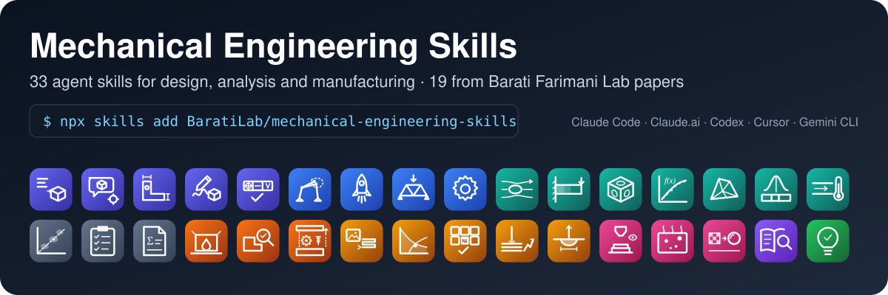
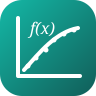
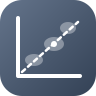

<p align="center"></p>


<video src="media/mes_launch.mp4" poster="media/poster_launch.jpg" controls playsinline preload="metadata" width="100%"></video>

**Watch:** [a 60-second tour](videos.md) · [six tasks before lunch, by voice and text](videos.md)

# Mechanical Engineering Skills — Barati Farimani Lab, Carnegie Mellon University

Agent skills for mechanical engineering design, analysis, simulation and manufacturing. Each skill
packages instructions and tested scripts. The agent orchestrates and the tools compute. They work
with Claude Code, Claude.ai, Cursor, Codex, Gemini CLI and other agents that follow the open Agent
Skills format.

```bash
npx skills add BaratiLab/mechanical-engineering-skills --all
```

🔬 marks skills that package a lab paper; their tutorial links open the step-by-step walkthrough.

### Design & CAD

<table>
<tr><th width="96"></th><th align="left">Skill</th><th align="left">What you can ask for</th><th align="left">Paper · Tutorial</th></tr>
<tr><td></td><td><a href="https://github.com/BaratiLab/mechanical-engineering-skills/tree/main/skills/cadsmith-text-to-cad"><b><code>cadsmith-text-to-cad</code></b></a> 🔬</td><td>Describe a part in words; get a CadQuery model checked by exact geometry measurements and a three-view review, exported as STEP/STL.</td><td><a href="https://arxiv.org/abs/2603.26512">CADSmith</a> · <a href="tutorials/cadsmith-text-to-cad.md">tutorial</a></td></tr>
<tr><td></td><td><a href="https://github.com/BaratiLab/mechanical-engineering-skills/tree/main/skills/query2cad-freecad"><b><code>query2cad-freecad</code></b></a> 🔬</td><td>Plain-language request to a FreeCAD macro, with automatic error repair and a visual self-check.</td><td><a href="https://arxiv.org/abs/2406.00144">Query2CAD</a> · <a href="tutorials/query2cad-freecad.md">tutorial</a></td></tr>
<tr><td></td><td><a href="https://github.com/BaratiLab/mechanical-engineering-skills/tree/main/skills/parametric-part-cad"><b><code>parametric-part-cad</code></b></a></td><td>Part specification in plain English to a parametric CadQuery script, STEP/STL and a preview.</td><td></td></tr>
<tr><td></td><td><a href="https://github.com/BaratiLab/mechanical-engineering-skills/tree/main/skills/sketch-to-cad"><b><code>sketch-to-cad</code></b></a></td><td>Hand sketch, photo or video frames to a dimensioned CAD model.</td><td></td></tr>
<tr><td></td><td><a href="https://github.com/BaratiLab/mechanical-engineering-skills/tree/main/skills/drawing-gdt-review"><b><code>drawing-gdt-review</code></b></a></td><td>Audit an engineering drawing for missing dimensions and GD&T errors.</td><td></td></tr>
<tr><td></td><td><a href="https://github.com/BaratiLab/mechanical-engineering-skills/tree/main/skills/linkage-synthesis"><b><code>linkage-synthesis</code></b></a> 🔬</td><td>Target motion path to a four- or six-bar linkage, built joint by joint and checked kinematically.</td><td><a href="https://arxiv.org/abs/2601.04054">LinkD</a> · <a href="tutorials/linkage-synthesis.md">tutorial</a></td></tr>
<tr><td></td><td><a href="https://github.com/BaratiLab/mechanical-engineering-skills/tree/main/skills/rocketsmith"><b><code>rocketsmith</code></b></a> 🔬</td><td>Hobby high-power rocket: stability, fin sizing, flight prediction, drag calibration and printable parts.</td><td><a href="https://arxiv.org/abs/2606.00097">RocketSmith</a> · <a href="tutorials/rocketsmith.md">tutorial</a></td></tr>
<tr><td></td><td><a href="https://github.com/BaratiLab/mechanical-engineering-skills/tree/main/skills/llm-mechanical-designer"><b><code>llm-mechanical-designer</code></b></a> 🔬</td><td>Truss design loop: the model proposes, exact FEM evaluates, the best designs are ranked.</td><td><a href="https://arxiv.org/abs/2404.17525">LLM Mechanical Designer</a> · <a href="tutorials/llm-mechanical-designer.md">tutorial</a></td></tr>
<tr><td></td><td><a href="https://github.com/BaratiLab/mechanical-engineering-skills/tree/main/skills/machine-element-sizing"><b><code>machine-element-sizing</code></b></a></td><td>Bolts, shafts, bearings, springs, gears and welds, with the work shown and safety factors.</td><td></td></tr>
</table>

### Analysis & simulation

<table>
<tr><th width="96"></th><th align="left">Skill</th><th align="left">What you can ask for</th><th align="left">Paper · Tutorial</th></tr>
<tr><td></td><td><a href="https://github.com/BaratiLab/mechanical-engineering-skills/tree/main/skills/cfd-simulation-setup"><b><code>cfd-simulation-setup</code></b></a> 🔬</td><td>Flow problem to an OpenFOAM case, run and diagnosis; results accepted only against physics checks.</td><td><a href="https://arxiv.org/abs/2610.14104">CFD Forge</a> · <a href="tutorials/cfd-simulation-setup.md">tutorial</a></td></tr>
<tr><td></td><td><a href="https://github.com/BaratiLab/mechanical-engineering-skills/tree/main/skills/stress-field-surrogate"><b><code>stress-field-surrogate</code></b></a> 🔬</td><td>Geometry, supports and loads to a full stress field in milliseconds, with its own FEM data generator.</td><td><a href="https://doi.org/10.1016/j.cma.2023.116343">StressD</a> · <a href="tutorials/stress-field-surrogate.md">tutorial</a></td></tr>
<tr><td></td><td><a href="https://github.com/BaratiLab/mechanical-engineering-skills/tree/main/skills/lattice-inverse-design"><b><code>lattice-inverse-design</code></b></a> 🔬</td><td>Target stiffness to a printable TPMS or hybrid lattice cell with its full stiffness matrix and a tiled STL.</td><td><a href="https://doi.org/10.1002/adfm.202404165">GLU3D</a> · <a href="tutorials/lattice-inverse-design.md">tutorial</a></td></tr>
<tr><td></td><td><a href="https://github.com/BaratiLab/mechanical-engineering-skills/tree/main/skills/equation-discovery"><b><code>equation-discovery</code></b></a> 🔬</td><td>Test data to an interpretable equation that extrapolates beyond the data.</td><td><a href="https://arxiv.org/abs/2404.18400">LLM-SR</a> · <a href="tutorials/equation-discovery.md">tutorial</a></td></tr>
<tr><td></td><td><a href="https://github.com/BaratiLab/mechanical-engineering-skills/tree/main/skills/quick-fea"><b><code>quick-fea</code></b></a></td><td>Linear static and modal FEA with a required hand-calculation check.</td><td></td></tr>
<tr><td></td><td><a href="https://github.com/BaratiLab/mechanical-engineering-skills/tree/main/skills/tolerance-stackup"><b><code>tolerance-stackup</code></b></a></td><td>Worst-case, RSS and Monte Carlo tolerance stack-ups with contributor charts.</td><td></td></tr>
<tr><td></td><td><a href="https://github.com/BaratiLab/mechanical-engineering-skills/tree/main/skills/thermal-fluids-calc"><b><code>thermal-fluids-calc</code></b></a></td><td>Pipe pressure drop, heat exchangers and fins with real fluid properties.</td><td></td></tr>
<tr><td></td><td><a href="https://github.com/BaratiLab/mechanical-engineering-skills/tree/main/skills/material-selection"><b><code>material-selection</code></b></a></td><td>Performance indices to a ranked material shortlist with Ashby charts.</td><td></td></tr>
<tr><td></td><td><a href="https://github.com/BaratiLab/mechanical-engineering-skills/tree/main/skills/design-review-package"><b><code>design-review-package</code></b></a></td><td>Requirements, FMEA, bill-of-materials cost roll-up and review checklist.</td><td></td></tr>
<tr><td></td><td><a href="https://github.com/BaratiLab/mechanical-engineering-skills/tree/main/skills/engineering-calc-report"><b><code>engineering-calc-report</code></b></a></td><td>Turn calculations into a calculation report ready for sign-off.</td><td></td></tr>
</table>

### Manufacturing

<table>
<tr><th width="96"></th><th align="left">Skill</th><th align="left">What you can ask for</th><th align="left">Paper · Tutorial</th></tr>
<tr><td></td><td><a href="https://github.com/BaratiLab/mechanical-engineering-skills/tree/main/skills/agentscad-fdm-dfam"><b><code>agentscad-fdm-dfam</code></b></a> 🔬</td><td>Make a STEP part printable by FDM: reorientation, teardrop holes and chamfers, with verified geometry.</td><td><a href="https://arxiv.org/abs/2607.02448">AgentsCAD</a> · <a href="tutorials/agentscad-fdm-dfam.md">tutorial</a></td></tr>
<tr><td></td><td><a href="https://github.com/BaratiLab/mechanical-engineering-skills/tree/main/skills/dfm-review"><b><code>dfm-review</code></b></a></td><td>Design-for-manufacture review for machining, sheet metal, molding and additive manufacturing.</td><td></td></tr>
<tr><td></td><td><a href="https://github.com/BaratiLab/mechanical-engineering-skills/tree/main/skills/mechanical-teardown"><b><code>mechanical-teardown</code></b></a></td><td>Product teardown: costed BOM, DFA index, should-cost, repairability and FMEA in an HTML report.</td><td>examples: <a href="https://baratilab.github.io/mechanical-engineering-skills/examples/mechanical-teardown-drill.html">drill</a> · <a href="https://baratilab.github.io/mechanical-engineering-skills/examples/mechanical-teardown-watch.html">watch</a></td></tr>
<tr><td></td><td><a href="https://github.com/BaratiLab/mechanical-engineering-skills/tree/main/skills/image2gcode"><b><code>image2gcode</code></b></a> 🔬</td><td>Photo or sketch to printer-ready G-code for 2D and 2.5D parts.</td><td><a href="https://doi.org/10.1016/j.addlet.2026.100374">Image2Gcode</a> · <a href="tutorials/image2gcode.md">tutorial</a></td></tr>
<tr><td></td><td><a href="https://github.com/BaratiLab/mechanical-engineering-skills/tree/main/skills/lpbf-defect-prediction"><b><code>lpbf-defect-prediction</code></b></a> 🔬</td><td>Laser power and speed to keyholing, lack of fusion or balling, with process maps.</td><td><a href="https://doi.org/10.1016/j.addlet.2025.100292">AdditiveLLM</a> · <a href="tutorials/lpbf-defect-prediction.md">tutorial</a></td></tr>
<tr><td></td><td><a href="https://github.com/BaratiLab/mechanical-engineering-skills/tree/main/skills/am-alloy-screening"><b><code>am-alloy-screening</code></b></a> 🔬</td><td>Known or new alloy to properties, a lack-of-fusion process map and a printability ranking.</td><td><a href="https://doi.org/10.1016/j.addlet.2026.100355">Agentic alloy evaluation</a> · <a href="tutorials/am-alloy-screening.md">tutorial</a></td></tr>
<tr><td></td><td><a href="https://github.com/BaratiLab/mechanical-engineering-skills/tree/main/skills/sls-process-optimization"><b><code>sls-process-optimization</code></b></a> 🔬</td><td>Polymer SLS test results to the next batch's settings, batch by batch.</td><td><a href="https://arxiv.org/abs/2608.25928">Agentic SLS</a> · <a href="tutorials/sls-process-optimization.md">tutorial</a></td></tr>
<tr><td></td><td><a href="https://github.com/BaratiLab/mechanical-engineering-skills/tree/main/skills/meltpool-geometry"><b><code>meltpool-geometry</code></b></a> 🔬</td><td>Melt-pool depth, width, length and mode from laser power, speed and alloy.</td><td><a href="https://doi.org/10.1016/j.addma.2022.102817">MeltpoolNet</a> · <a href="tutorials/meltpool-geometry.md">tutorial</a></td></tr>
<tr><td></td><td><a href="https://github.com/BaratiLab/mechanical-engineering-skills/tree/main/skills/llm-3d-print-monitor"><b><code>llm-3d-print-monitor</code></b></a> 🔬</td><td>Camera inspection of every layer and bounded in-print corrections on Klipper printers.</td><td><a href="https://doi.org/10.1016/j.addma.2025.105027">LLM-3D Print</a> · <a href="tutorials/llm-3d-print-monitor.md">tutorial</a></td></tr>
<tr><td></td><td><a href="https://github.com/BaratiLab/mechanical-engineering-skills/tree/main/skills/thermal-porosity"><b><code>thermal-porosity</code></b></a> 🔬</td><td>Thermal images recorded during printing to pore count and location for each layer.</td><td><a href="https://doi.org/10.1016/j.addma.2024.104503">ThermoPore</a> · <a href="tutorials/thermal-porosity.md">tutorial</a></td></tr>
<tr><td></td><td><a href="https://github.com/BaratiLab/mechanical-engineering-skills/tree/main/skills/lpbf-superres"><b><code>lpbf-superres</code></b></a> 🔬</td><td>Low-cost webcam images to high-resolution layer images and edge roughness.</td><td><a href="https://doi.org/10.1016/j.addma.2025.104790">LPBF super-resolution</a> · <a href="tutorials/lpbf-superres.md">tutorial</a></td></tr>
<tr><td></td><td><a href="https://github.com/BaratiLab/mechanical-engineering-skills/tree/main/skills/am-literature-rag"><b><code>am-literature-rag</code></b></a> 🔬</td><td>Page-cited answers from your own additive-manufacturing paper library.</td><td><a href="https://doi.org/10.1016/j.addlet.2024.100232">AMGPT</a> · <a href="tutorials/am-literature-rag.md">tutorial</a></td></tr>
</table>

### Teaching

<table>
<tr><th width="96"></th><th align="left">Skill</th><th align="left">What you can ask for</th><th align="left">Paper · Tutorial</th></tr>
<tr><td></td><td><a href="https://github.com/BaratiLab/mechanical-engineering-skills/tree/main/skills/worked-problem-generator"><b><code>worked-problem-generator</code></b></a></td><td>Textbook-style problems with code-verified solutions.</td><td></td></tr>
<tr><td></td><td><a href="https://github.com/BaratiLab/mechanical-engineering-skills/tree/main/skills/mechanics-visuals"><b><code>mechanics-visuals</code></b></a></td><td>Free-body diagrams, Mohr's circle, beam diagrams and S–N curves.</td><td></td></tr>
</table>

## Research skills (from lab papers)
[Use cases and pipelines](use-cases.md)

### Design
- [CADSmith: text → validated CadQuery](tutorials/cadsmith-text-to-cad.md)
- [Query2CAD: text → FreeCAD macro](tutorials/query2cad-freecad.md)
- [LinkD: target curve → planar linkage](tutorials/linkage-synthesis.md)
- [LLM Agent as a Mechanical Designer: truss design loop](tutorials/llm-mechanical-designer.md)
- [CFD Forge: physics-constrained CFD](tutorials/cfd-simulation-setup.md)
- [StressD: instant stress fields](tutorials/stress-field-surrogate.md)
- [GLU3D: lattice cells for a target stiffness](tutorials/lattice-inverse-design.md)
- [LLM-SR: equation discovery](tutorials/equation-discovery.md)
- [RocketSmith: printed high-power rockets](tutorials/rocketsmith.md)

### Manufacturing
- [AgentsCAD: DFAM for FDM parts](tutorials/agentscad-fdm-dfam.md)
- [Image2Gcode: image → G-code](tutorials/image2gcode.md)
- [AdditiveLLM: L-PBF defect regimes and process maps](tutorials/lpbf-defect-prediction.md)
- [LLM-3D Print: layer-by-layer monitoring and correction](tutorials/llm-3d-print-monitor.md)
- [Agentic alloy evaluation: which alloy prints](tutorials/am-alloy-screening.md)
- [Agentic SLS process optimization](tutorials/sls-process-optimization.md)
- [MeltpoolNet: melt-pool size and mode](tutorials/meltpool-geometry.md)
- [ThermoPore: porosity from thermal images](tutorials/thermal-porosity.md)
- [Diffusion super-resolution of layer images](tutorials/lpbf-superres.md)
- [AMGPT: page-cited answers from your AM library](tutorials/am-literature-rag.md)

## Engineering skills
Machine element sizing, quick FEA, tolerance stack-up, thermal-fluids, DFM review, material selection, design review packages, calculation reports, drawing / GD&T review, parametric CAD, sketch-to-CAD, worked problems, and mechanics visuals. See the [repository README](https://github.com/BaratiLab/mechanical-engineering-skills#skills-by-category).

## Writing your own skill
See [CONTRIBUTING.md](https://github.com/BaratiLab/mechanical-engineering-skills/blob/main/CONTRIBUTING.md).
