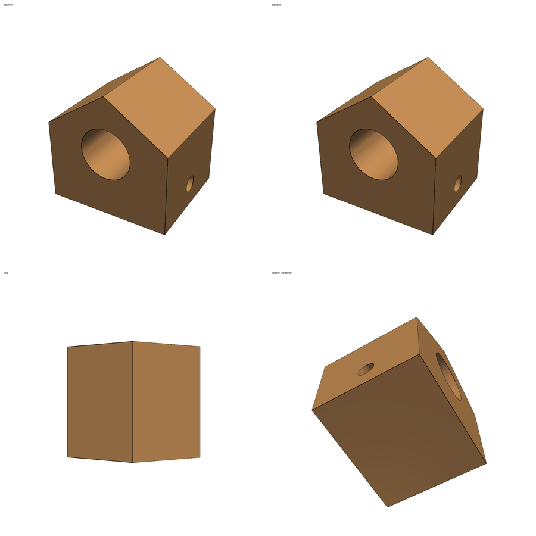
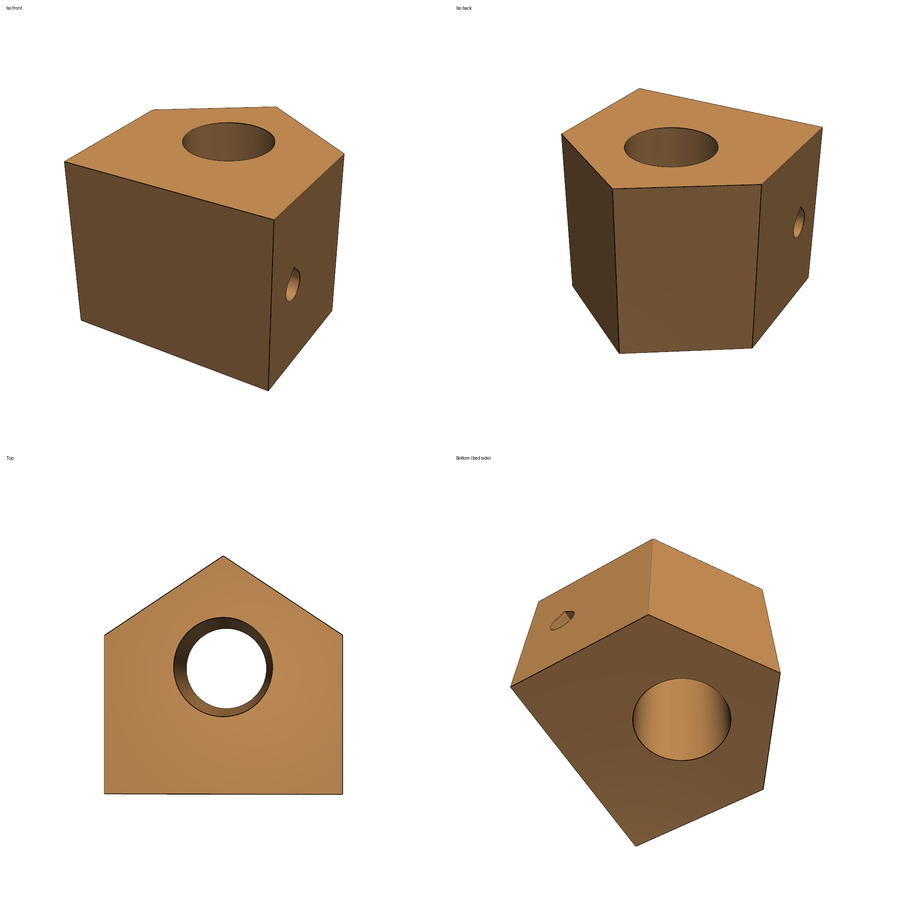

# Tutorial: AgentsCAD (design for additive manufacturing of FDM parts)

**Skill:** [`agentscad-fdm-dfam`](../../skills/agentscad-fdm-dfam) · **Paper:** E. George, C. Keefe, P. Pak, A. Barati Farimani, *AgentsCAD: Automated Design for Manufacturing of FDM Parts via Multi-Agent LLM Reasoning and Geometric Feature Recognition*, [arXiv:2607.02448](https://arxiv.org/abs/2607.02448)

Slicers flag overhangs but can't change the geometry. AgentsCAD turns a STEP file into an LLM-readable blackboard (per-face JSON plus an adjacency graph), detects overhangs by rule, has the agent reason about reorientation and local fixes with grounding tools, applies the fixes programmatically, and verifies the result. Its key finding: **without the orientation tools, the agent hallucinated rotation angles**. With them, those errors disappeared.

## Use cases
- **Make a CAD part printable without supports**: horizontal holes → teardrops, ledges → 45° chamfers, best bed orientation.
- **Choose a print orientation with numbers**, not intuition: overhang count and area, bed contact, height, for each candidate.
- **Explain DFAM to students**: every decision is tied to a face ID and a tool output.
- **Build a lab memory of DFAM decisions**: retrieval-augmented memory recalls what worked on similar parts.

## Setup
```bash
npx skills add BaratiLab/me-design-skills --skill agentscad-fdm-dfam
pip install cadquery pyvista numpy
python examples/make_birdhouse.py birdhouse.step      # the paper-style test part
```

## Walkthrough: the birdhouse
A nine-face birdhouse: seven planar faces, an Ø25 entrance bore along Y and an Ø8 perch hole along X, the same structure as the paper's test case.



**1. Parse to the blackboard**
```bash
python scripts/dfam.py analyze birdhouse.step --out bb.json
```
```
summary: {"actionable": 2}
overhangs: face 6 horizontal_bore −90°, Ø8   → suggested teardrop
           face 8 horizontal_bore −90°, Ø25  → suggested teardrop
```
The floor (face 0) faces straight down but sits on the bed, so it's correctly not flagged.

**2. Orientation sub-phase (grounded, at most 4 candidates)**
```bash
python scripts/dfam.py candidates birdhouse.step
```
| Candidate | rx, ry | Actionable | Height | Bed contact |
|---|---|---|---|---|
| as modelled | 0, 0 | 2 | 60 | — |
| face 0 on bed | 0, 0 | 2 | 60 | 3000 mm² |
| **face 3 on bed** | **−90, 180** | **1** | **50** | 2509 mm² |
| face 4 on bed | 90, 180 | 1 | 50 | 2509 mm² |
| face 1 on bed | −180, −90 | 1 (Ø25 left) | 60 | 1950 mm² |

Laying end face 3 on the bed makes the entrance bore vertical, which eliminates it. The Ø8 perch hole stays horizontal. That's the same resolution the paper reports.

**3. The Design Reasoner writes typed operations** (`examples/birdhouse_mods.json`):
```json
{"operations": [{"op": "teardrop", "face_id": 6},
                {"op": "reorient", "rx_deg": -90.0, "ry_deg": 180.0, "bed_face": 3}]}
```
Reorient is applied **last**, because rotation re-indexes faces. The teardrop is built to point up in the *final* build direction.

**4. Modify and verify**
```bash
python scripts/dfam.py modify birdhouse.step --plan examples/birdhouse_mods.json --out birdhouse_dfam.step
python scripts/dfam.py verify birdhouse.step birdhouse_dfam.step --plan examples/birdhouse_mods.json --out verify
```
```
kernel: valid, 1 solid, volume Δ −0.17 %, faces 9 → 11
overhangs: 2 actionable → 0
pass_deterministic: true
```


The verifier also produces yes/no questions for a vision check, one per modification ("Does the hole that was face_6 now have a pointed teardrop top that points up?") plus integrity questions. The paper used GPT-4o; any independent vision model or a reviewer works.

**5. Remember it**
```bash
python scripts/dfam.py memory add --bb bb.json --decision examples/birdhouse_mods.json --note "Lay the large-bore end face on the bed; teardrop the remaining small bores."
```
A later bracket with one horizontal bore retrieved this decision with similarity 0.96.

## Lessons the tests encode
- Judge bores by what actually **faces down**. After a teardrop cut, the remaining cylindrical face is just the lower arc; an axis-only rule would keep flagging it forever.
- The teardrop flanks must be **tangent** at 45°. A triangle that isn't tangent leaves a thin sliver of the overhanging crown.

## Prompts to try
- *"Make bracket.step printable on my Prusa without supports; explain every change."*
- *"Which orientation should I print this housing in? Show the candidates."*
