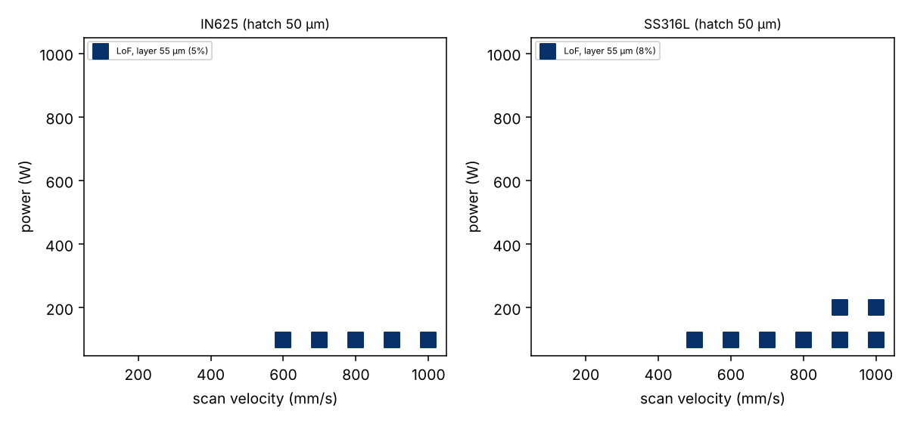
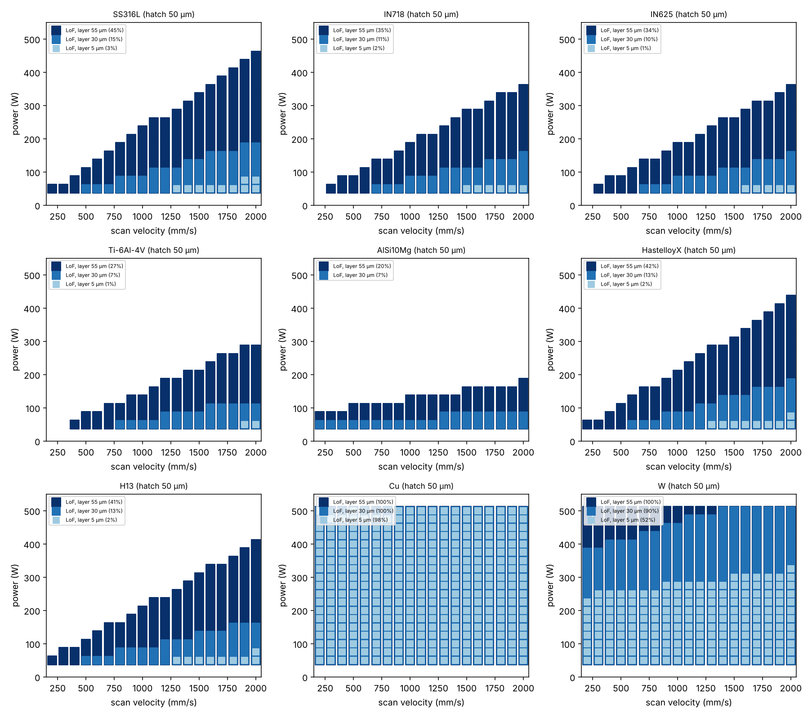

# Tutorial: agentic AM alloy evaluation (composition → LoF process map → ranking)

**Skill:** [`am-alloy-screening`](https://github.com/BaratiLab/mechanical-engineering-skills/tree/main/skills/am-alloy-screening) · **Paper:** P. Pak, A. Chandrasekhar, A. Barati Farimani, *Agentic additive manufacturing alloy evaluation*, Additive Manufacturing Letters 17 (2026) 100355, [doi:10.1016/j.addlet.2026.100355](https://doi.org/10.1016/j.addlet.2026.100355) · **Code:** [BaratiLab/Agentic-Additive-Manufacturing-Alloy-Evaluation](https://github.com/BaratiLab/Agentic-Additive-Manufacturing-Alloy-Evaluation)

"Can I print this alloy, and with what settings?" normally takes CALPHAD software, a melt-pool model
and someone who knows both. The paper gave an LLM agent MCP tools for three steps:
1. Thermo-Calc properties for any composition
2. a Rosenthal melt pool
3. a lack-of-fusion (LoF) process map

The agent then ranks candidates for an application. Agent and tools reproduced literature process
windows for 11 of 12 known alloys and evaluated new compositions.

In this skill the agent is Claude and `alloy.py` holds the tools. Thermo-Calc is used when it is
installed; otherwise built-in alloy data or flagged estimates stand in.

## Use cases
- **Alloy selection by application:** for corrosion resistance, which of IN625 and SS316L has the
  wider window?
- **New compositions:** a first printability check of Fe-10Ni-10Ti or SS316L without Mo, before
  buying powder.
- **Process window starting points:** where LoF begins for your hatch and layer, at ±25 µm layers.
- **Auditing material files:** catch density in g/m³ and Cp in J/mol·K before they corrupt a map.

## Setup
```bash
npx skills add BaratiLab/mechanical-engineering-skills --skill am-alloy-screening
pip install numpy matplotlib          # + Thermo-Calc with TC-Python for new compositions (optional)
cd skills/am-alloy-screening
```

## 1. Compositions and properties
```bash
python scripts/alloy.py compose "Fe-18Cr-10Ni-2Mo"        # {"Fe":0.70,"Cr":0.18,"Ni":0.10,"Mo":0.02}
python scripts/alloy.py properties --alloy IN625 --out IN625.json
python scripts/alloy.py properties --alloy SS316L --out SS316L.json
python scripts/alloy.py properties --comp "Fe-10Ni-10Ti" --out FeNiTi.json      # add --thermocalc if you have it
```
Without Thermo-Calc, the new Fe-Ni-Ti composition gets a rule-of-mixtures density and Cp, plus
k, solidus and liquidus borrowed from the nearest built-in alloy (H13, at distance 0.19). It is
labelled **low confidence**, with a warning to get CALPHAD or measured values.

## 2. A process map
```bash
python scripts/alloy.py map --material SS316L.json --hatch 50 --layer 30 --power 50:500:25 --velocity 200:2000:100 --out ss316l.png
```
- LoF appears at low power and high speed, as expected.
- At the prescribed 30 µm layer, LoF covers 15% of this grid; at 55 µm it covers 45%.
- The four SS316L settings the paper cites as high-density (150 W/500 mm/s, 200/700, 250/900,
  300/1100) all fall **outside** LoF.

## 3. Rank candidates for an application
```bash
python scripts/alloy.py rank --materials IN625.json SS316L.json --hatch 50 --layer 30 --out corrosion.png
```


**IN625 ranks first**, the same choice the paper's agent made. On the paper's default grid (100–1000
W, 100–1000 mm/s) neither alloy has LoF at 30 µm, so the tie is broken by the LoF fraction over all
three layers (1.7% vs 2.7%) and then by overlap headroom.

On a wider grid, nine built-in alloys rank:
1. AlSi10Mg
2. Ti-6Al-4V
3. IN625
4. IN718
5. H13
6. Hastelloy X
7. SS316L
8. W
9. Cu

Pure Cu comes last: with about 15% IR absorptivity and very high conductivity, the conduction model
predicts LoF everywhere.



## 4. A finding in the paper's own outputs
`check` on the repository's Thermo-Calc material files for Ti-6Al-4V, Monel K500, H13 and Al 7050
shows two slips:
- **density about 1000× too high** (4.40e6 "kg/m³" for Ti-6Al-4V);
- **Cp of about 30**, which is J/mol·K rather than J/kg·K.

Thermal diffusivity, and so the melt pools and maps for those alloys, would be off by about 50–100×.
The skill fixes both automatically: density ÷1000, and Cp divided by the alloy's molar mass.
```bash
python scripts/alloy.py check results/known_alloys/titanium_process_map/materials/TI6AL4V.json
# unit_fixes: ["density /1000 ...", "Cp converted from J/mol/K to J/kg/K ..."]
```

## Limits
- Rosenthal is conduction mode only. The LoF boundary is conservative, and keyholing and balling are
  not predicted; pair with [`lpbf-defect-prediction`](lpbf-defect-prediction.md) and
  [`meltpool-geometry`](meltpool-geometry.md).
- New compositions need CALPHAD or measurement. The skill says so in its output.

Cite: Pak, Chandrasekhar & Barati Farimani, *Addit. Manuf. Lett.* 17 (2026) 100355.
