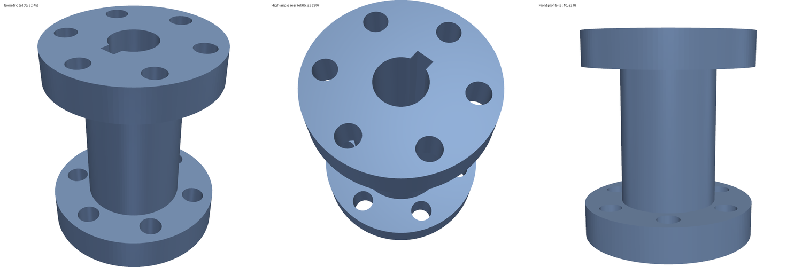

# Tutorial: CADSmith (text → validated CadQuery)

**Skill:** [`cadsmith-text-to-cad`](https://github.com/BaratiLab/me-design-skills/tree/main/skills/cadsmith-text-to-cad) · **Paper:** J. Barkley, R. Loghmani, A. Barati Farimani, *CADSmith: Multi-Agent CAD Generation with Programmatic Geometric Validation*, [arXiv:2603.26512](https://arxiv.org/abs/2603.26512)

Five roles (Planner → Coder → Executor → Validator → Refiner) run in two nested loops: up to 3 repairs for execution errors and up to 5 refinements for wrong geometry. Validation combines exact OpenCASCADE kernel measurements with a three-view render judged by an **independent** reviewer. Results from the paper's 100-prompt benchmark: 100% execution rate, median IoU 0.963 (zero-shot 0.809), mean Chamfer distance 0.74 (zero-shot 28.4).

## Use cases
- **Parts from specs with exact dimensions**: brackets, flanges, couplings, plates with hole patterns, where "looks right" isn't enough.
- **Catching silent LLM CAD errors**: diameter-vs-radius slips, holes off the part, disconnected bodies, invalid solids.
- **Benchmarking text-to-CAD** with the paper's metrics (Chamfer distance, F1 at 1 mm, voxel IoU, all in absolute mm after ICP).
- **CAD for downstream analysis**: the STEP goes straight into `quick-fea` or `agentscad-fdm-dfam`.

## Setup
```bash
npx skills add BaratiLab/me-design-skills --skill cadsmith-text-to-cad
pip install cadquery trimesh scipy rtree pyvista matplotlib
```

## Walkthrough: the paper's T3 example (flanged shaft coupling)
> *"A flanged shaft coupling standing along the Z axis, centered at the origin in X and Y … bottom flange 50 mm diameter, 10 mm thick (Z=0–10), hub 28 mm diameter, 40 mm long (Z=10–50), top flange 50 mm, 10 mm thick (Z=50–60). Six bolt holes 6.5 mm on a 38 mm pitch circle diameter. A 14 mm center bore the full length. A keyway 5 mm wide, 2.5 mm deep on the +X bore wall."*

**1. Plan** (no code yet), in `plan.json`: three coaxial components, `target_bbox [50, 50, 60]`, holes `Ø6.5 ×6` and `Ø14 ×1`, `n_solids: 1`.

**2. Retrieve API knowledge**:
```bash
python scripts/cadsmith.py kb "polarArray hole keyway bore cylinder union"
```
This returns KB1 entries, including the polarArray pitfall: *"radius = PCD/2"*.

**3. Code, execute, check.** A typical first attempt passes the PCD (a diameter) to `polarArray`:
```bash
python scripts/cadsmith.py execute part_v0_bug.py --out runs/coupling/bug
python scripts/cadsmith.py check --plan plan.json --metrics runs/coupling/bug_metrics.json
```
```
"passed": false, "issues": ["holes Ø6.5: found 0 cylindrical faces, expected ≥6"]
```
The bbox was a perfect 50 × 50 × 60 and the solid was valid, but the holes landed outside the flange. This is the *false convergence* the paper warns about, and only the hole check catches it. The refiner fixes `polarArray(PCD / 2, …)`.

**4. Re-execute, then render the three judge views** (isometric, high-angle rear, front profile, as in the paper):
```bash
python scripts/cadsmith.py execute part.py --out runs/coupling/v0     # bbox 50.0 × 50.0 × 60.0, valid, 1 solid
python scripts/cadsmith.py check --plan plan.json --metrics runs/coupling/v0_metrics.json   # passed
python scripts/cadsmith.py render runs/coupling/v0.stl --out runs/coupling/v0_views.png
```


The judge counts six holes per flange, the bore with its +X keyway, and the hub between the flanges, and confirms the bbox, so the part passes. Use a separate subagent as the judge when possible; the paper used a stronger, independent model to avoid self-confirmation.

**5. Benchmark against a reference** (an independently built revolve):
```bash
python scripts/cadsmith.py eval runs/coupling/v0.stl runs/coupling/ref.stl
```
| Model | Chamfer distance | F1 @ 1 mm | IoU | Noise floor (ref vs ref) |
|---|---|---|---|---|
| Correct coupling | 1.100 | 0.838 | 0.996 | CD 1.096, F1 0.842 |
| PCD bug | 2.125 | 0.791 | 0.946 | — |

**Read metrics against the noise floor.** With 10k sample points, two identical parts can't reach CD = 0 or F1 = 1 at τ = 1 mm. The correct part sits at the floor.

## Lessons the tests encode
- An **oversized fillet** doesn't always raise: OpenCASCADE can return an *invalid* solid silently. The hard kernel check (`valid == false`) fails it regardless of how it looks.
- An early version of this skill's renderer drew interior faces over the surface, a fake "slit" in the hub. A judge shown a bad render will hallucinate defects, so the skill renders with VTK's z-buffer.

## Prompts to try
- *"Use CADSmith to model a 120 × 80 × 6 mm plate with a 4 × 3 grid of M6 clearance holes, 10 mm edge margins; give me STEP and a dimension report."*
- *"Generate the paper's T3 coupling and benchmark it against my reference STL."*
