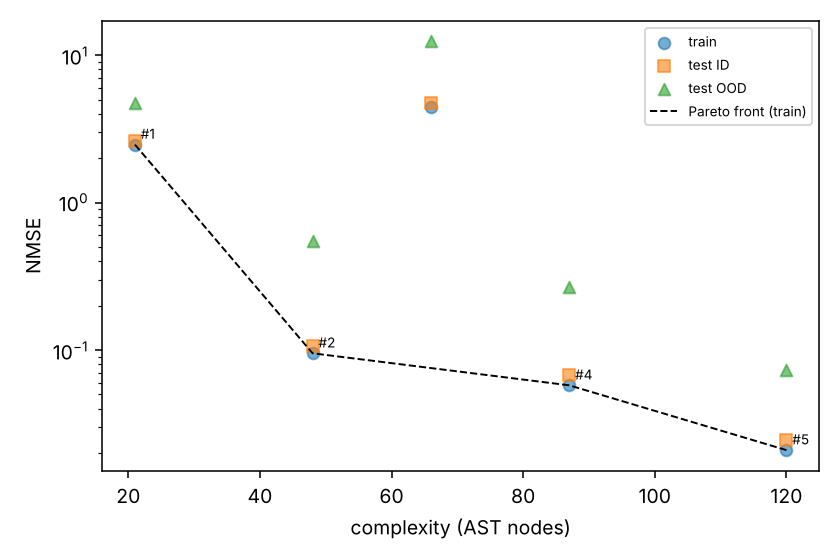

# Tutorial: LLM-SR equation discovery (data → interpretable law that extrapolates)

**Skill:** [`equation-discovery`](https://github.com/BaratiLab/mechanical-engineering-skills/tree/main/skills/equation-discovery) · **Papers:** P. Shojaee, K. Meidani, S. Gupta, A. Barati Farimani, C.K. Reddy, *LLM-SR: Scientific Equation Discovery via Programming with Large Language Models*, ICLR 2025 (Oral), [arXiv:2404.18400](https://arxiv.org/abs/2404.18400); P. Shojaee, N.H. Nguyen, K. Meidani, A. Barati Farimani, K.D. Doan, C.K. Reddy, *LLM-SRBench*, ICML 2025, [arXiv:2504.10415](https://arxiv.org/abs/2504.10415) · **Code:** [deep-symbolic-mathematics/LLM-SR](https://github.com/deep-symbolic-mathematics/LLM-SR)

Symbolic regression usually searches blind over operators. LLM-SR lets an LLM write **equation
skeletons as programs**, guided by what it knows about the physics: saturation, damping, Arrhenius,
power laws. An optimizer fits the constants, and the best programs come back as examples for the next
proposal.

In this skill Claude proposes and `eqdisc.py` fits, scores and remembers.

## Use cases
- **Constitutive laws** from test data: stress–strain–temperature, creep, fatigue.
- **Process correlations** for manufacturing: melt-pool size, surface roughness, tool wear.
- **Replacing black-box fits** when you need to extrapolate, or to explain the model to a reviewer.
- **Benchmarking** on the LLM-SR problems or LLM-SRBench.

## Setup
```bash
npx skills add BaratiLab/mechanical-engineering-skills --skill equation-discovery
pip install numpy scipy pandas scikit-learn matplotlib
cd skills/equation-discovery
```

## Walkthrough: aluminium stress–strain across temperature (LLM-SR's `stressstrain`)
```bash
python scripts/eqdisc.py fetch --problem stressstrain --dir ss/
python scripts/eqdisc.py baseline --dir ss/
```
The baselines, as NMSE on train / validation (in-domain test) / held-out temperature:
- linear: 0.380 / 0.377 / 1.31
- cubic polynomial: 0.161 / 0.150 / 0.680

The held-out split is one temperature (0.667) that isn't in the training set but lies inside the
training range (0.067–1.0). It tests generalization to an unseen condition by interpolation, not
extrapolation; hold out the hottest condition if you need to test extrapolation.

Looking at slices of the data: stress rises steeply, saturates, and drops at large strain (necking),
and the plateau falls with temperature. The proposals, scored with
`eval --dir ss/ --src '...' --note '...'`:

| # | Idea | Params | NMSE (train / validation / held-out T) |
|---|---|---|---|
| 2 | Voce saturation `σ_sat(T)·(1 − e^(−kε))`, σ_sat linear in T | 3 | 0.095 / 0.107 / 0.549 |
| 3 | + necking `−p·ε^n` | 5 | failed: ε < 0 in the data gives NaN, so use `np.abs` |
| 4 | + softening that scales with T | 6 | 0.058 / 0.068 / 0.269 |
| 5 | + quadratic thermal softening, T-dependent stiffness | 8 | **0.021 / 0.025 / 0.074** |

```bash
python scripts/eqdisc.py prompt --dir ss/ --k 3      # the LLM-SR-style prompt for proposal #6
python scripts/eqdisc.py pareto --dir ss/ --out front.png
```


The final law has 8 constants and is **9× more accurate than the cubic polynomial at the unseen
temperature** (0.074 vs 0.680). Every term has a physical reading: elastic stiffness, a
saturation stress that falls with temperature, and necking softening.

## Rules
- Change one idea per proposal and write why in `--note`. The buffer becomes your lab notebook.
- Choose from the Pareto front by **validation** error and simplicity, not by train error alone.
- Keep the final test untouched while searching: `eval`, `prompt`, `top` and `pareto` hide it. Run
  `final --id N` once, on the equation you have frozen.
- This walkthrough shows held-out scores at every step for teaching. The skill now hides them during
  a real search, so these numbers come from a replay, not from a blind test.
- Skeletons run in an isolated subprocess with numpy only and a time limit.

Cite: Shojaee et al., ICLR 2025; Shojaee et al., ICML 2025.
