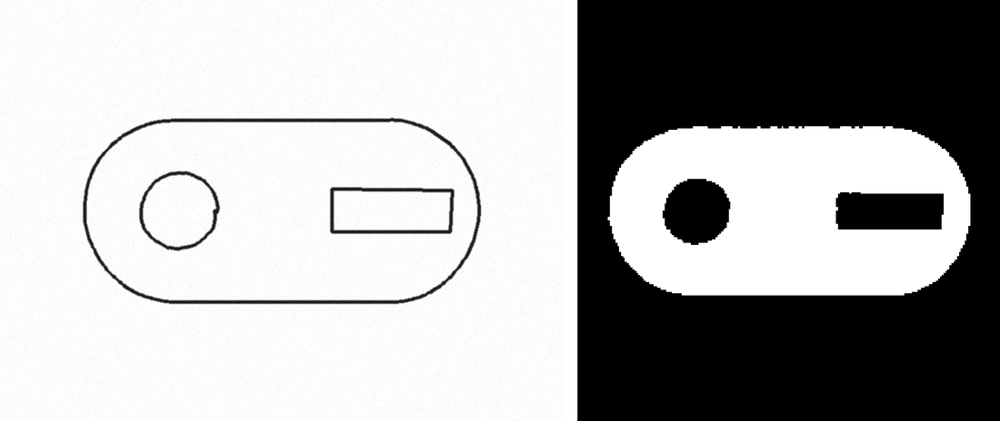
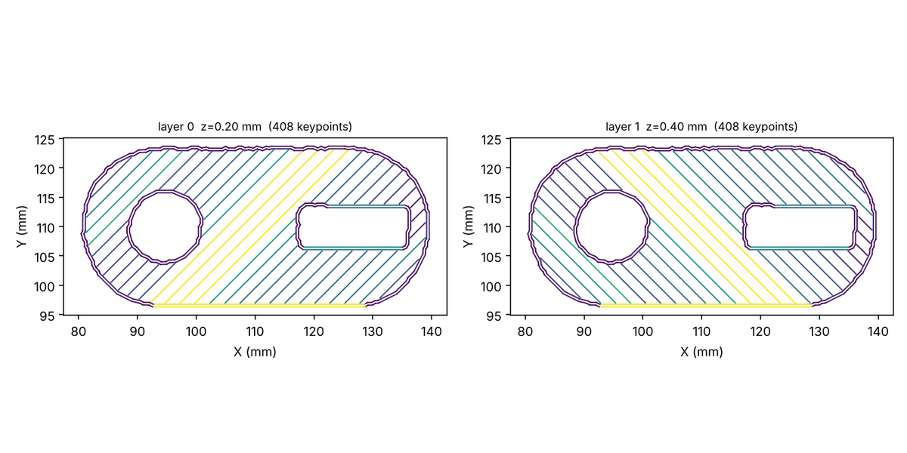

# Tutorial: Image2Gcode (photo or sketch → printer-ready G-code)

**Skill:** [`image2gcode`](https://github.com/BaratiLab/mechanical-engineering-skills/tree/main/skills/image2gcode) · **Paper:** Z. Wang, Y. Jadhav, P. Pak, A. Barati Farimani, *Image2Gcode: Image-to-G-code generation for additive manufacturing using diffusion-transformer model*, Additive Manufacturing Letters 17 (2026) 100374, [doi:10.1016/j.addlet.2026.100374](https://doi.org/10.1016/j.addlet.2026.100374)

Image2Gcode skips CAD and slicing for 2D and 2.5D parts. The image becomes a boundary silhouette, a toolpath is generated as per-layer (X, Y, E) keypoints, and post-processing writes printer-ready G-code. The paper's generator is a diffusion model (DinoV2 encoder + 1-D U-Net) trained on Slice-100K. Its weights are available from the authors on request, so this skill bundles the **exact input and output contract** with a deterministic perimeter-plus-infill generator in the model's slot. See [`ddpm_hook.md`](https://github.com/BaratiLab/mechanical-engineering-skills/blob/main/skills/image2gcode/references/ddpm_hook.md) for dropping in the trained model.

## Use cases
- **Print from a sketch or photo** of a flat part (gasket, shim, bracket plate, coaster, replacement cover) without CAD.
- **Repair and replacement**: photograph a broken flat part on paper, set its real size, and print.
- **Teaching manufacturing**: the jump from image to toolpath shows what a slicer does.
- **Toolpath datasets and analysis**: convert any slicer G-code to Slice-100K-style normalized keypoints; compare travel distance between strategies.
- **Deploying the Image2Gcode model**: the keypoint format, denormalization, and validation are already wired.

## Setup
```bash
npx skills add BaratiLab/mechanical-engineering-skills --skill image2gcode
pip install opencv-python-headless shapely numpy matplotlib
python examples/make_sketch.py sketch.png        # a synthetic pen sketch with a hole and a slot
```

## Walkthrough: pen sketch → 60 mm part
**1. Preprocess** (edge detection → contour hierarchy → filled 224 × 224 silhouette):
```bash
python scripts/i2g.py preprocess sketch.png --out sil.png --mode sketch
```


Check the silhouette before going on: material white, holes black.

**2. Generate** (60 mm long, 15 layers × 0.2 mm, 2 perimeters, 25% rectilinear):
```bash
python scripts/i2g.py generate sil.png --size-mm 60 --layers 15 --out part.gcode
```
Toolpath area: **1276.4 mm²**, against 1278.7 mm² for the drawn part at that scale (0.2% off).

**3. Validate and plot**
```bash
python scripts/i2g.py validate part.gcode --bed 220 220 250
python scripts/i2g.py plot part.gcode --out paths.png --layers 0,1
```
```
ok: true · layers 15 · z 0.2–3.0 mm · filament 600.7 mm · travel 22 575 mm
```


Two perimeters close around the outline and both holes, and the infill alternates ±45° and stays inside the walls.

**4. Keypoints (the model's representation) and re-emission**
```bash
python scripts/i2g.py keypoints part.gcode --out kp.npz     # (layers, Nmax, 3) in [-1,1] + mask
python scripts/i2g.py emit kp.npz --layer 0 --size-mm 40 --out layer0_40mm.gcode
```
The parser handles absolute and relative modes, mid-file `G92 E` resets, and constant-E travels (`examples/tricky_modes.gcode` is in the tests). `emit` rescales the same keypoints to any physical size with `--flow-mult` for your printer, which is the paper's point about decoupling geometry from machine settings.

## Lessons the tests encode
- A drawn outline is a **stroke band**, so contours nest four deep (outer edge, inner edge, hole-stroke outer edge, hole-stroke inner edge). Fill and clear by depth, or the hole disappears.
- Keep the travel endpoint as a keypoint with constant E. Otherwise separate infill strokes get chained into extrusions across holes.

## Prompts to try
- *"Here's a photo of a gasket on graph paper (50 mm across); make G-code for a 2 mm thick TPU print."*
- *"Convert this Prusa G-code to Image2Gcode keypoints and report travel distance per layer."*
