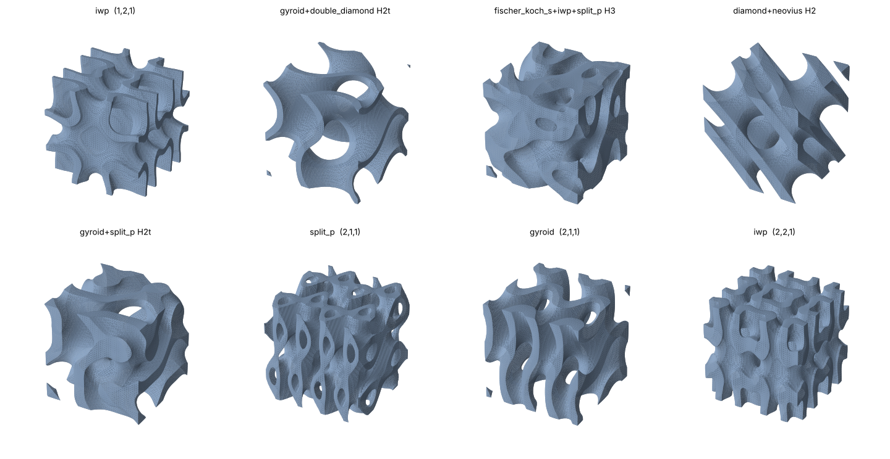
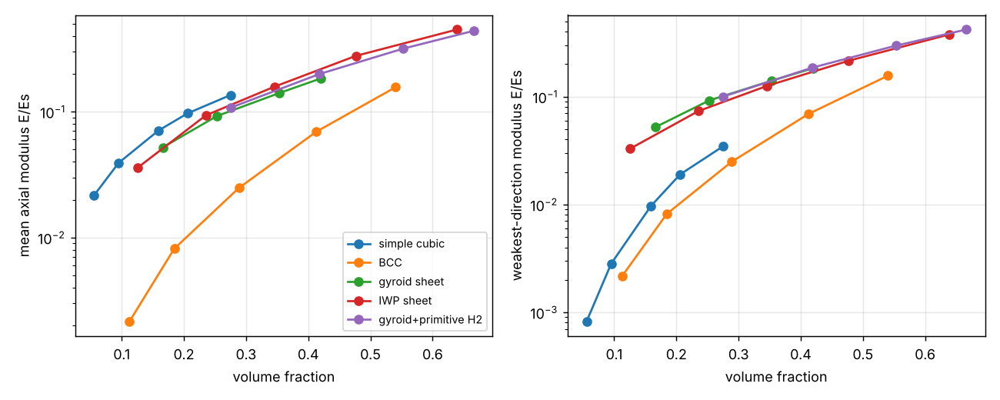
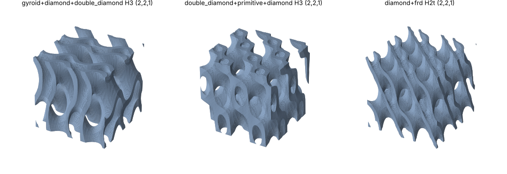
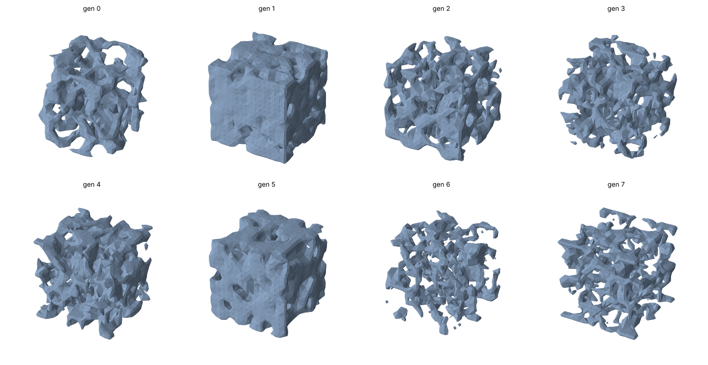

# Tutorial: GLU3D (lattice unit cells for a target stiffness)

**Skill:** [`lattice-inverse-design`](https://github.com/BaratiLab/mechanical-engineering-skills/tree/main/skills/lattice-inverse-design) · **Paper:** Y. Jadhav, J. Berthel, C. Hu, R. Panat, J. Beuth, A. Barati Farimani, *Generative Lattice Units with 3D Diffusion for Inverse Design: GLU3D*, Advanced Functional Materials 34 (2024) 2404165, [doi:10.1002/adfm.202404165](https://doi.org/10.1002/adfm.202404165)

Architected lattices give a printed part a stiffness and weight of your choosing, if you can find
the right unit cell. GLU3D turns the usual trial-and-error around. You give it a target 6 × 6
stiffness matrix, and a 3D diffusion model produces the implicit field of a new cell. That field
becomes a mesh to print or voxels to analyse.

The training cells were TPMS surfaces and **hybrids** that blend two to four TPMS families. A tanh
scaling keeps every generated surface at level set 0, which took mesh yield to 100%. Printed PLA
cells followed the requested modulus.

## Use cases
- **Lightweight infill or cores** with a set stiffness, either isotropic or stiffer along the load
  path.
- **Matching a modulus.** Implants and bone scaffolds need E close to bone; grips and pads need a
  given compliance.
- **Comparing TPMS against strut lattices** at equal weight before committing to a design.
- **Your own generative model:** build a printable, homogenised dataset and train on it.

## Setup
```bash
npx skills add BaratiLab/mechanical-engineering-skills --skill lattice-inverse-design
pip install numpy scipy scikit-image trimesh matplotlib pyamg   # + torch for the models
cd skills/lattice-inverse-design
python tests/test_glu3d.py        # 20 checks, ~1 min
```
Stiffness is reported **relative to the solid** (E/Es). Multiply by your material's printed
modulus: PLA ≈ 3.5 GPa, Ti-6Al-4V ≈ 110 GPa.

## 1. Build and check a cell
```bash
python scripts/glu3d.py cell --families gyroid --h 0.25 --res 49 --png gyroid.png
python scripts/glu3d.py cell --families gyroid,primitive --mode H2 --t 0.3 --h 0.2 --stl h2.stl --cell-mm 10 --tiles 2,2,2
python scripts/glu3d.py cell --families gyroid --h 0.25 --freq 2,2,1          # anisotropic
```
Every cell goes through the same checks a printer would care about:
- the solid is one periodic piece that reaches every face;
- every void region opens to the faces, so no powder or resin is trapped;
- the opposite faces match (periodicity error 0).

It is then **homogenised**. This is a periodic voxel FEM that gives the full 6 × 6 stiffness, the
engineering constants, the Zener anisotropy ratio and the weakest and strongest directional
modulus. The homogeniser is exact on cases with known answers: a solid cell, and the C33, C44 and
C11 of a laminate.



The paper scales each axis (s_x, s_y, s_z) to make cells anisotropic. Here that is `--freq`, the
integer number of periods per axis. A sheet gyroid with `--freq 2,2,1` has E3 ≈ 2.8 × E1 at the
same density.

## 2. How do they compare with strut lattices?
```bash
python scripts/glu3d.py compare --cells '[["gyroid sheet",{"families":["gyroid"]}],["IWP sheet",{"families":["iwp"]}],["gyroid+primitive H2",{"families":["gyroid","primitive"],"mode":"H2","t":0.3}]]' --png compare.png
```


At a volume fraction of about 0.25:
- The TPMS and hybrid sheets are about **5× stiffer than BCC**.
- They are 3× stiffer than simple cubic in SC's **weakest direction**, although SC is about 1.3×
  stiffer along its own axes.
- This is why the skill reports the directional minimum: E1 alone would make simple cubic look
  best.

This is the elastic half of the paper's Fig. 9. The paper's claims about energy absorption and
peak load came from compression tests, so test coupons for those.

## 3. Inverse design: what cell gives E1 = E2 = 0.06, E3 = 0.15?
```bash
python scripts/glu3d.py dataset --n 300 --res 33 --hres 24 --out ds.npz    # ~30 min on a laptop CPU
python scripts/glu3d.py search --target E1=0.06,E2=0.06,E3=0.15 --data ds.npz --budget 30
```
- **Building the dataset.** 300 cells were accepted out of 1634 tried. Rejections:

  | Reason | Cells |
  |---|---|
  | Sealed cavities | 748 |
  | Duplicates (Dice > 0.75) | 366 |
  | Solid in pieces | 193 |

  49% of accepted cells are anisotropic (E max/min > 1.2).
- **Search** ranked the dataset against the target, then refined thickness and bias by
  re-homogenising. It took 2 minutes.
- **Best result:** a gyroid + diamond + double-diamond H3 hybrid with two periods in x and y.
  - At 24³ it gave E = (0.058, 0.058, 0.147) at vf 0.26, about 3% mean log error.
  - Re-checked at 48³ it gave (0.057, 0.058, 0.151).



Paste the winner's `spec` from the search output to export it as a watertight, capped STL. For
10 mm cells tiled 3 × 3 × 3 at `--res 49`, the volume is 6835 mm³ (vf 0.25) in about 2 million
triangles. Lower `--res` gives a lighter file.
```bash
python scripts/glu3d.py cell --spec '{"families":["gyroid","diamond","double_diamond"],"mode":"H3","t":0.744,"h":0.209,"a":-0.187,"freq":[2,2,1],"kind":"sheet"}' \
    --res 49 --stl lattice.stl --cell-mm 10 --tiles 3,3,3
```

## 4. The generative route (the paper's model)
```bash
python scripts/glu3d.py train-surrogate --data ds.npz --out sur.pt
python scripts/glu3d.py train --data ds.npz --out glu3d.pt --surrogate sur.pt --size 64 --chans 1,4,8,16,32,64 --device cuda
python scripts/glu3d.py generate --model glu3d.pt --target E=0.1,G=0.04 --vfrac 0.3 --n 8 --steps 100
python scripts/glu3d.py evaluate --gen generated.npz --data ds.npz
```
**Training defaults follow the paper:**
- 3D U-Net with ResNet blocks;
- cosine schedule, T = 500;
- Huber loss;
- 20% unconditional training;
- stiffness entries standardised to mean 50;
- tanh scaling with φ̂min = 0.75;
- a frozen surrogate's loss added to the diffusion loss.

**One deliberate change:** volume fraction is part of the conditioning vector. The paper traced its
failures on high-modulus targets to leaving it out. Use `--paper-cond` to reproduce the paper's
setting.

**What `evaluate` reports:**
- the paper's success rate (vf > 0.05 and a closed surface);
- the periodicity error;
- Dice, Chamfer and Hausdorff distance to the training set;
- the stiffness error **re-measured by homogenisation**, not by the surrogate.

Keep only generated cells whose re-measured stiffness hits the target.

**CPU rehearsal (honest numbers).** Setup: the 300-cell dataset at 16³ on a laptop CPU,
250 epochs, about 20 minutes. Results for 20 test-set stiffness targets:

| Metric | Result |
|---|---|
| Success rate (paper's definition) | 100% |
| Periodicity error | 0 |
| Best Dice vs. training set | 0.52 |
| Re-homogenised stiffness error (mean relative) | 200–280% |



**The pipeline works end to end, but a model this small does not yet produce usable cells.** The
paper trained on 3723 cells at 64³ for 500 epochs on four GPUs. For one-off designs, use the
search in step 3. Train the generative model when you have that scale of data and a GPU, and keep
only the cells that pass re-homogenisation.

**What it took to get structure out of small data.** Each of these is recorded in the paper notes:
- **Periodic training.** The model trains on the periodic grid with circular padding, so every
  sample is periodic by construction. The paper's zero-padded network only learns
  near-periodicity.
- **Time embedding.** Sinusoidal features feed a learnable MLP. A free per-step table sees each of
  the 500 steps too rarely.
- **Conditioning scale.** The stiffness vector, standardised to mean 50, is divided by 50 inside
  the encoder.
- **Learning-rate patience.** A longer plateau patience stops the rate decaying to nothing.
- **Sampling.** The sampler recomputes the noise from the clipped x₀.

Before these changes the samples were pure noise; the periodicity error was 1.5 out of a maximum
of 3.

Cite: Jadhav et al., *Adv. Funct. Mater.* 34 (2024) 2404165.
