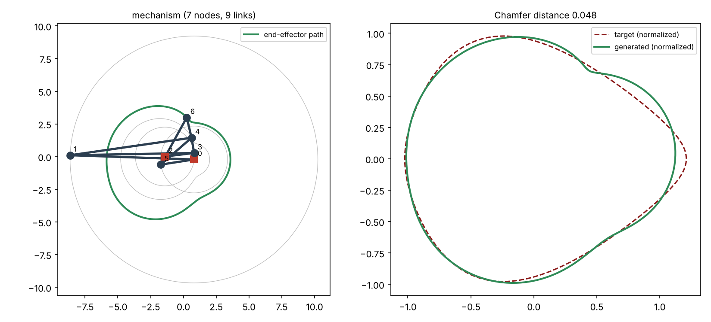

# Tutorial: LinkD (target curve → planar linkage)

**Skill:** [`linkage-synthesis`](https://github.com/BaratiLab/mechanical-engineering-skills/tree/main/skills/linkage-synthesis) · **Paper:** *LinkD: Autoregressive diffusion for mechanical linkage synthesis*, Barati Farimani Lab, [arXiv:2601.04054](https://arxiv.org/abs/2601.04054)

LinkD designs one-degree-of-freedom planar linkages whose end-effector traces a target curve.

How it represents a mechanism:
- Each mechanism is an **N × 24 graph matrix**. Every row holds a node's validity flag, its
  type (fixed, revolute or crank pad), its normalized x and y, and 20 lower-triangular
  adjacency entries. N is at most 20.
- A trained diffusion model builds the graph **one node at a time**.
- Each new node must attach to exactly two known nodes, which makes it a dyad.

How each proposal is checked:
- The kinematics are simulated over 200 crank angles.
- If the law of cosines has no solution at some angle (|cos φ| > 1), that is a branch defect,
  and the node is resampled. Up to K = 25 retries are allowed per node.

Success rates in the paper:

| Retry strategy | Success rate |
|---|---|
| One-shot | 29.4% |
| Graph-level retry | 96.7% |
| Node-level retry | 99.6% |

The paper does not release the trained weights. The skill therefore keeps the representation,
the validation, the node-by-node construction with bounded retries, and the Chamfer metric
exactly as published. In place of the diffusion sampler, an optimizer proposes nodes:
differential evolution, then Nelder–Mead. It also adds **practicality limits** (link ratio,
pivot spacing, overall size), so a fit cannot come from a mechanism nobody could build.

## Use cases
- **Path generation**: a gripper finger, a walking-robot foot, a film-advance claw, a
  pick-and-place arc, or a toy mechanism that must follow a drawn curve.
- **Six-bar upgrades**: when the best four-bar can't follow the shape, the skill adds one
  dyad at a time and keeps the addition only if the fit improves by more than 2%.
- **Checking an existing linkage**: verify it moves through the full rotation without
  locking, and measure how far the joints come from colliding.
- **Datasets and research**: encode and decode LinkD's N×24 matrices, and score any generator
  with the paper's Chamfer distance (raw or rotation-invariant).
- **Teaching**: coupler curves, Grashof behaviour, and why some links lock.

## Setup
```bash
npx skills add BaratiLab/mechanical-engineering-skills --skill linkage-synthesis
pip install numpy scipy matplotlib
cd skills/linkage-synthesis
```

## 1. Check that it can recover a known mechanism
Simulate the example four-bar, then ask the synthesizer to find a mechanism for that curve
without being told the answer:
```bash
python scripts/linkage.py validate examples/fourbar.json
python scripts/linkage.py simulate examples/fourbar.json --out fourbar_curve.csv
python scripts/synth.py fourbar_curve.csv --out recovered.json --max-nodes 5
```
The second four-bar attempt reached **CD = 0.0002**, meaning the recovered mechanism traces
the same curve. Run this check whenever you change the code.

## 2. Synthesize for a shape a four-bar can't follow
```bash
python scripts/synth.py --preset bean --out bean.json --max-nodes 7
python scripts/linkage.py plot bean.json --target bean_target.csv --out bean.png
```
The log shows the paper's construction loop at work:
```
[four-bar] attempt 2: CD = 0.0526
[grow] 7 nodes: CD = 0.0497
[grow] no proposal improved the fit after 25 retries; stopping at 7 nodes
```


**Result:**
- A 7-node, 9-link six-bar with Chamfer distance **0.048** after arc-length resampling, or
  0.047 if a rotated or mirrored installation is allowed.
- The validation pass found it topologically and kinematically valid through the full turn.
- Link-length drift was 1e-14.
- Practicality: link ratio 8.0, at the limit; smallest link 0.125 of the largest; ground
  pivots 0.24 apart.

The fit is good everywhere except the convex lobe on the right. That lobe is what the next
dyad would have had to fix, and none of the 25 proposals improved it by more than 2%.

## 3. Read the numbers correctly
- **Two Chamfer protocols.** LinkD compares curves sampled at 200 equal crank angles (Eq. 7,
  mean nearest-neighbour L2 in both directions). Applied to a target drawn by hand, that
  scores even a perfect mechanism badly, because the crank does not move at constant arc
  speed. The skill resamples by arc length for search and reporting. `compare --raw` gives
  the paper's protocol when both curves come from mechanisms.
- **For scale:** the paper's mean CD was 0.121, 0.145 and 0.188 under its three settings,
  measured on its own normalization.
- **Invariance:** `--invariant` searches 72 rotations and a reflection. Use it only if the
  mechanism may be installed rotated or mirrored.

## 4. Make it real
- Export the joint coordinates from `bean.json`, scaled to your size, and check link
  thickness and clearances in CAD (see `parametric-part-cad`).
- Size the pins with `machine-element-sizing`.
- `linkage.py validate` reports the minimum joint separation over the cycle. Keep it larger
  than the pin diameter.

Cite: LinkD, arXiv:2601.04054.
