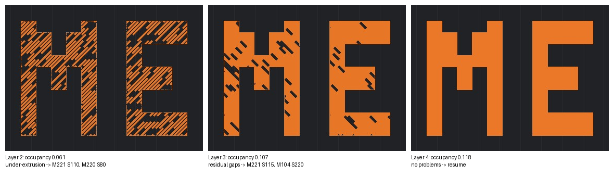

# Tutorial: LLM-3D Print (agent monitors and corrects an FDM print layer by layer)

**Skill:** [`llm-3d-print-monitor`](../../skills/llm-3d-print-monitor) · **Paper:** Y. Jadhav, P. Pak, A. Barati Farimani, *LLM-3D Print: Large language models to monitor and control 3D printing*, Additive Manufacturing 114 (2025) 105027, [arXiv:2408.14307](https://arxiv.org/abs/2408.14307) · **Code:** [BaratiLab/LLM-3D-Print…](https://github.com/BaratiLab/LLM-3D-Print-Large-Language-Models-To-Monitor-and-Control-3D-Printing)

In LLM-3D Print, a Klipper printer pauses after every layer and parks the head clear of two
cameras. A team of agents then works on that layer:
1. A vision-language model describes the defects.
2. A planner decides what to look up.
3. An executor queries Moonraker.
4. A solution planner chooses G-code corrections.
5. An executor applies them, and the print resumes.

The paper validated failure detection against 14 engineers and showed prints improving over
successive layers.

In this skill, **the agent you are talking to does the looking and the planning**.
`printer.py` is the executor and supervisor:
- It enforces the paper's stage order.
- It blocks anything outside a short, bounded allowlist.
- It applies plans all-or-nothing, and only with `--live`.
- It logs every step.

A mock printer renders camera images from the simulated process state, so you can rehearse
the whole loop without hardware.

## Use cases
- **Babysitting a long print**: the agent checks each layer, or every N layers, and makes
  small corrections instead of letting a defect spread.
- **Rescuing a print in progress**: under-extrusion from a partial clog, stringing on a humid
  day, or blobs after a filament change.
- **Training and teaching**: the session log is a worked record of observation → hypothesis
  → query → change → evidence.
- **Research on closed-loop AM**: swap in your own detector, keep the safety gate and the
  audit trail.

## Setup
```bash
npx skills add BaratiLab/me-design-skills --skill llm-3d-print-monitor
pip install numpy pillow
cd skills/llm-3d-print-monitor
```
For a real printer:
- Follow [`klipper_setup.md`](../../skills/llm-3d-print-monitor/references/klipper_setup.md):
  two webcams named `top` and `front`, `[pause_resume]`, `[firmware_retraction]`, and a
  `LAYER_INSPECT` macro.
- Then post-process the sliced file:
```bash
python scripts/add_layer_pauses.py part.gcode part_mon.gcode --every 1
```
On the paper's own spanner G-code with `--every 2`, this found 21 layers from the slicer
comments and inserted 10 pauses.

## Walkthrough: rescuing an under-extruding print (mock printer)
```bash
python scripts/mock_moonraker.py --port 7125 --fault underextrusion &   # hidden partial clog: 82% real flow
export MOONRAKER_URL=http://127.0.0.1:7125
P="python scripts/printer.py --session runs/me_letters"
$P wait && $P snapshot
```

**Layer 2.** The agent reads `top.jpg` and `front.jpg`. The infill lines are broken into
dashes, perimeters have missing segments, and the front view shows a discontinuous layer.
It records this
([`d2.json`](../../skills/llm-3d-print-monitor/examples/d2.json)):
```bash
$P record detect d2.json            # failures: under-extrusion, rating 4
$P record plan p2.json              # → refused: "gather information before planning a fix"
$P query extruder gcode_move firmware_retraction   # temp at target, flow 100%, speed 100%
$P record plan p2.json              # M221 S110 (+10% flow), M220 S80 (slow to 80%)
$P apply && $P apply --live && $P resume --live
```

**Layer 3.** Occupancy rose from 0.061 to 0.107. Short gaps remain. The agent's first plan
also included `SET_GCODE_OFFSET Z_ADJUST=-0.2`. The safety gate refused the whole plan,
because the Z step limit is ±0.05 mm, and **nothing was sent**. The agent resubmitted
`M221 S115` and `M104 S220`.

**Layer 4.** The infill is solid and occupancy is 0.118. The agent records "No problems
found" and resumes without a plan.



`$P report` prints the audit trail:
```
## Layer 2
- snapshot: occupancy {'top': 0.0614, 'front': 0.0133}
- detect: Problems found; failures: ['under-extrusion']; rating 4
- query: extruder, gcode_move, firmware_retraction
- apply LIVE: `M221 S110` → sent
- apply LIVE: `M220 S80` → sent
## Layer 3
- apply LIVE: `SET_GCODE_OFFSET Z_ADJUST=-0.2` → BLOCKED: Z_ADJUST must be within ±0.05 mm
- apply LIVE: `M221 S115` → sent
- apply LIVE: `M104 S220` → sent
## Layer 4
- detect: No problems found; rating 9
```

## Why the safety gate is strict
The paper's own run logs show what happens without one. With four or five changes per layer,
the agents pushed speed down to 30%, retraction up to 7 mm, and stacked several Z offsets.

The skill therefore enforces:
- one or two levers per layer;
- caps on each step (flow ±10%, hotend ±15 °C from the start, Z ±0.05 mm per step and
  ±0.2 mm total);
- a block on motion, homing, firmware and config commands entirely;
- dry-run until you add `--live`.

Two more rules:
- If the same fix fails twice, the agent stops and names a likely hardware cause (clog, wet
  filament) for a person to check.
- Layer shift, spaghetti or a detached part means **stop and tell the user**.

See [`playbook.md`](../../skills/llm-3d-print-monitor/references/playbook.md) for the defect → lever table.

Cite: Jadhav, Pak & Barati Farimani, *Additive Manufacturing* 114 (2025) 105027.
