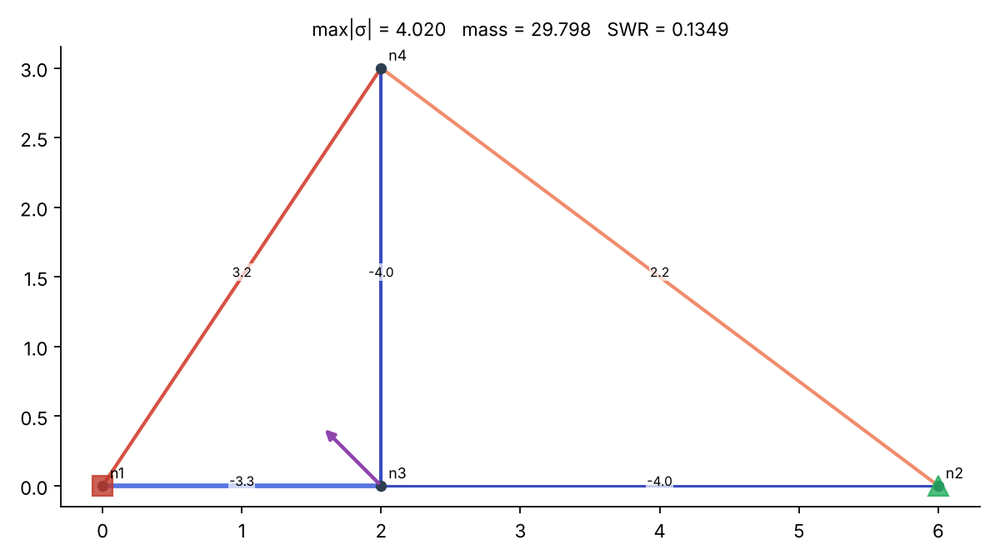

# Tutorial: LLM Agent as a Mechanical Designer (truss design loop)

**Skill:** [`llm-mechanical-designer`](https://github.com/BaratiLab/me-design-skills/tree/main/skills/llm-mechanical-designer) · **Paper:** Y. Jadhav, A. Barati Farimani, *Large Language Model Agent as a Mechanical Designer*, J. Engineering Design (2026), [arXiv:2404.17525](https://arxiv.org/abs/2404.17525) · **Reference code:** [BaratiLab/LLLM-Agent-Mechanical-Designer](https://github.com/BaratiLab/LLLM-Agent-Mechanical-Designer)

The agent proposes a truss (node positions, members, discrete cross-sections). An exact FEM scores it. A ranked history of every design is fed back, with an **optimize** prompt when the design is feasible and a **constraint** prompt when it isn't, until the agent decides further gains are marginal.

## Use cases
- **Early-stage structural layout.** "Carry 10 kN at this node with max stress 15 and mass under 30." The agent explores topology, which gradient and genetic optimizers struggle with when nodes and connectivity are free.
- **Teaching design iteration.** Students watch a reasoning trace (load path → topology → sizing → check) driven by real FEM feedback.
- **Benchmarking LLMs as optimizers.** The six paper tasks (`t1v1`–`t2v3`) are built in, and the FEM matches the paper's reference code to 1e-4.
- **Discrete-section problems.** Choosing from a catalogue of areas (standard angle or tube sizes), where continuous sizing methods don't apply.
- **Mixed variables.** Node coordinates (continuous), connectivity (graph), and section IDs (categorical) in one loop.

## Setup
```bash
npx skills add BaratiLab/me-design-skills --skill llm-mechanical-designer
pip install numpy matplotlib
```
Ask Claude: *"Use the llm-mechanical-designer skill to solve Task 1 Variation 1 from the paper."* The transcript below is a real session.

## 1. Start the run
```bash
python scripts/design_loop.py init --task t1v1 --run run
```
Task 1, Variation 1: fixed nodes `node_1 (0,0)` pinned, `node_2 (6,0)` roller, `node_3 (2,0)` loaded with `[-10, -45]` (that is, Fx = −7.07, Fy = +7.07 in the reference convention). Constraints: max |σ| ≤ 15, mass Σ L·A ≤ 30. `run/prompt_next.md` now holds the INITIAL prompt with its scratchpad sections.

## 2. Iterate: the agent answers, the FEM scores
Each design is a JSON file; `eval` runs the FEM, updates the ranked history, and writes the next prompt.

```bash
python scripts/design_loop.py eval --run run d1.json
```

| Iter | Change (agent's reasoning) | max \|σ\| | mass | Status → next |
|---|---|---|---|---|
| 1 | Minimal triangulated truss: apex `node_4 (2, 2.5)` above the load, 5 members | 9.042 | 18.70 | FEASIBLE → OPTIMIZE |
| 2 | Critical members are the vertical (−9.04) and left diagonal (7.72) at area ID 2 → up-size both to ID 3 | 6.164 | 24.27 | FEASIBLE → OPTIMIZE |
| 3 | Bottom-left chord now critical (−6.16) → ID 4 | 5.687 | 27.01 | FEASIBLE → OPTIMIZE |
| 4 | Right chord is lightly stressed (−2.14) but heavy (7.0) → down-size to ID 2, spend the mass on the critical right diagonal (5.69 → ID 3) | 4.823 | 27.71 | FEASIBLE → OPTIMIZE |
| 5 | Geometry: raise the apex to y = 3.0 (deeper truss → smaller chord forces) | **4.020** | 29.80 | FEASIBLE → OPTIMIZE |
| 6 | Mass limit is active and the two critical members are balanced → `"stop": true` | — | — | stop accepted |

```bash
python scripts/design_loop.py best --run run
```


Final: max |σ| = 4.020 (limit 15), mass = 29.80 (limit 30), SWR = 0.135, after 6 FEM calls. For scale, the paper's NSGA-II baseline used 500 generations × 100 population.

## 3. Guards you get for free
- **Stopping on an infeasible design is refused.** The loop switches to the CONSTRAINT prompt instead.
- **Invalid designs are caught before ranking**: moved load or support nodes, duplicate members, floating nodes, mechanisms (a singular stiffness matrix).
- **The design is scored by code, not by the model's estimate.** Ask Claude to show the scratchpad estimate next to the FEM value; the gap is instructive in a class setting.

## Prompts to try
- *"Run t2v1 (stress-to-weight ≤ 0.5) and compare your best design with the paper's."*
- *"Design a 4 m cantilever truss carrying 5 kN at the tip, max stress 120, with area IDs 1–6; plot the best design."* (Claude writes a custom task JSON.)
- *"Run t1v3 three times and report the spread of the best max-stress."*

## Notes
The load convention follows the reference code: `[m, a]` gives Fx = m·cos a, Fy = m·sin a. The prompt templates are re-written from the paper's structure (task status, inputs, objectives, constraints, scratchpads, output format). There's no buckling check; ask for an Euler check on compression members if it matters.
