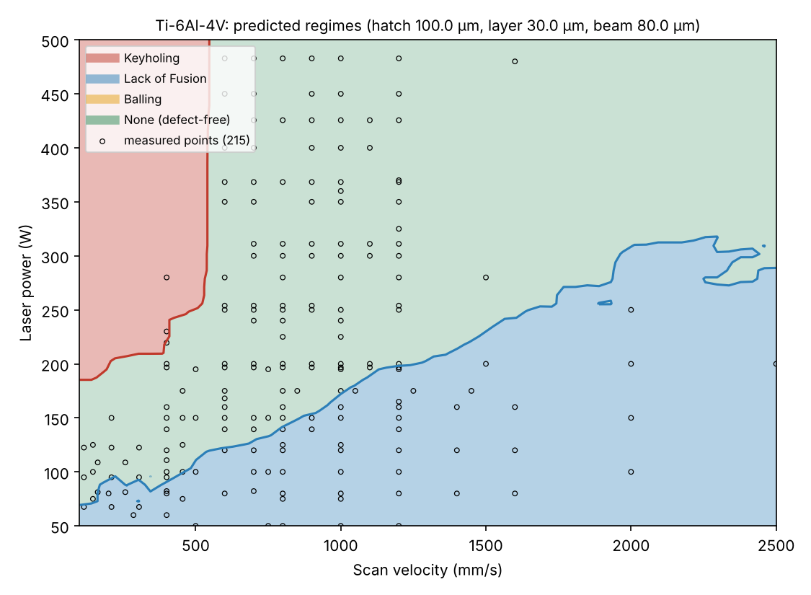
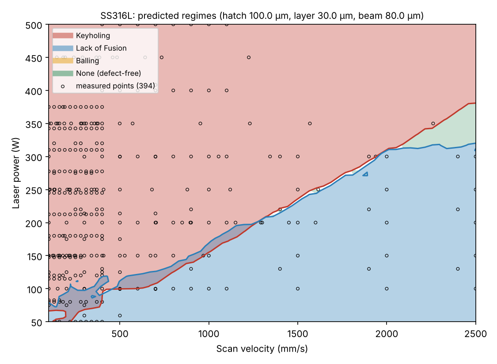

# Tutorial: AdditiveLLM (L-PBF parameters → defect regime)

**Skill:** [`lpbf-defect-prediction`](../../skills/lpbf-defect-prediction) · **Paper:** P. Pak, A. Barati Farimani, *AdditiveLLM: Large language models predict defects in metals additive manufacturing*, Additive Manufacturing Letters 14 (2025) 100292, [doi:10.1016/j.addlet.2025.100292](https://doi.org/10.1016/j.addlet.2025.100292) · [arXiv:2501.17784](https://arxiv.org/abs/2501.17784) · **Data:** [MeltpoolNet](https://github.com/BaratiLab/MeltpoolNet) (Akbari et al., Additive Manufacturing 55 (2022) 102817)

Laser powder bed fusion parts fail in three ways that show up in the melt pool:
- **Keyholing:** too deep a melt pool traps vapour pores.
- **Lack of fusion:** tracks or layers don't overlap.
- **Balling:** a long melt pool breaks up into beads.

AdditiveLLM labelled MeltpoolNet's measured melt pools with three geometric criteria. It then
augmented each melt pool over a 20 × 20 grid of hatch spacing and layer height, and
fine-tuned small LLMs on text such as
`SS316L [SEP] 200 W [SEP] 800 mm/s [SEP] 80 microns [SEP] 100 microns [SEP] 30 microns`.
The best model, Llama-3.2-1B, reached **94.2%** exact-match accuracy.

This skill rebuilds the dataset from the public MeltpoolNet CSVs and trains a fast
gradient-boosted model with **physics monotonic constraints**, for example that more power
never makes keyholing less likely. It answers three questions:
1. Do these melt-pool dimensions pass the criteria?
2. What regime will these parameters give?
3. Where is the safe window?

## Use cases
- **Screen parameters before a build**: "Ti-6Al-4V, 280 W, 1200 mm/s, 100 µm hatch, 30 µm
  layer: will it keyhole?"
- **Process windows**: a power–velocity map for a fixed hatch and layer, with the most
  robust point marked and the measured data drawn on top.
- **Interpreting single-track experiments**: measured depth, width and length give an exact
  criteria verdict with the arithmetic shown.
- **Planning a DOE**: put density cubes around the robust point instead of sweeping the
  whole space.
- **Fine-tuning an LLM as in the paper**: the built dataset already has the Baseline text
  column (see `references/finetune.md`).

## Setup
```bash
npx skills add BaratiLab/me-design-skills --skill lpbf-defect-prediction
pip install numpy pandas scikit-learn matplotlib pyarrow joblib scipy
cd skills/lpbf-defect-prediction
```

## 1. Criteria from measured dimensions
```bash
python scripts/lpbf.py criteria --depth 120 --width 150 --length 420 --hatch 100 --layer 40
```
```
labels: ["Keyholing"]
Keyholing       width/depth = 1.25 (< 1.5)
Lack of Fusion  (h/W)^2 + (t/D)^2 = 0.56 (<= 1)
Balling         length/width = 2.80 (<= pi)
```
If a dimension is missing, that criterion is reported as not evaluated. It is never counted
as passing.

## 2. Build the dataset and train (about 1 minute)
```bash
python scripts/lpbf.py build --out data.parquet
python scripts/lpbf.py train --data data.parquet --model model.joblib
```
The build produces 324,850 rows:
- 1,241 directly classified tracks;
- 1,209 rows labelled from their melt-pool dimensions;
- 322,400 augmented rows (806 melt pools × 400 hatch/layer pairs).

Validation exact match:

| Split | This skill | AdditiveLLM, best LLM |
|---|---|---|
| Random 75/15/10, the paper's protocol | 98.1% | 94.2% |
| **Grouped**: whole melt pools held out (default) | **87.9%** (macro-F1 0.886) | not reported |

The random split leaks. Augmented copies of the same melt pool end up in both train and
validation, and once W and D are memorised the lack-of-fusion label is a closed-form function
of hatch and layer. **87.9% is the number to quote** for a parameter set the model hasn't
seen. Turning off the monotonic constraints (`--no-monotone`) drops it to 83.9%.

## 3. Predict a parameter set
```bash
python scripts/lpbf.py predict --model model.joblib --material Ti-6Al-4V \
    --power 280 --velocity 1200 --beam 80 --hatch 100 --layer 30
```
- Probabilities: Keyholing 0.05, Lack of Fusion 0.01, Balling 0.00.
- Prediction: **None**.
- Volumetric energy: 78 J/mm³.

At 350 W and 300 mm/s the same alloy gives **Keyholing** with probability 0.98.

## 4. Map the window
```bash
python scripts/lpbf.py map --model model.joblib --material Ti-6Al-4V --hatch 100 --layer 30 --beam 80 --out map_ti64.png
```


The map shows the textbook shape:
- keyholing at low speed and high power;
- lack of fusion below a line of roughly constant energy;
- a defect-free band between the two.

The most robust point is about **233 W at 870 mm/s**.

Treat the map with care:
- Circles mark measured tracks for this alloy. Where there are none, the map is extrapolating.
- The criteria come from single tracks. For SS316L, many conduction-mode tracks have
  W/D < 1.5, so the map is conservative about keyholing:



## 5. Report it like an engineer
- Give the regime and probability, the energy density, and the physical lever:
  - keyhole: lower P or raise v;
  - LoF: lower hatch or layer, or raise energy;
  - balling: reduce v at the same energy.
- Say whether the point is inside the measured data.
- Recommend single tracks and density cubes around the point. The model narrows the search;
  qualification still decides.

Cite: Pak & Barati Farimani, *Addit. Manuf. Lett.* 14 (2025) 100292; Akbari et al., *Addit. Manuf.* 55 (2022) 102817.
