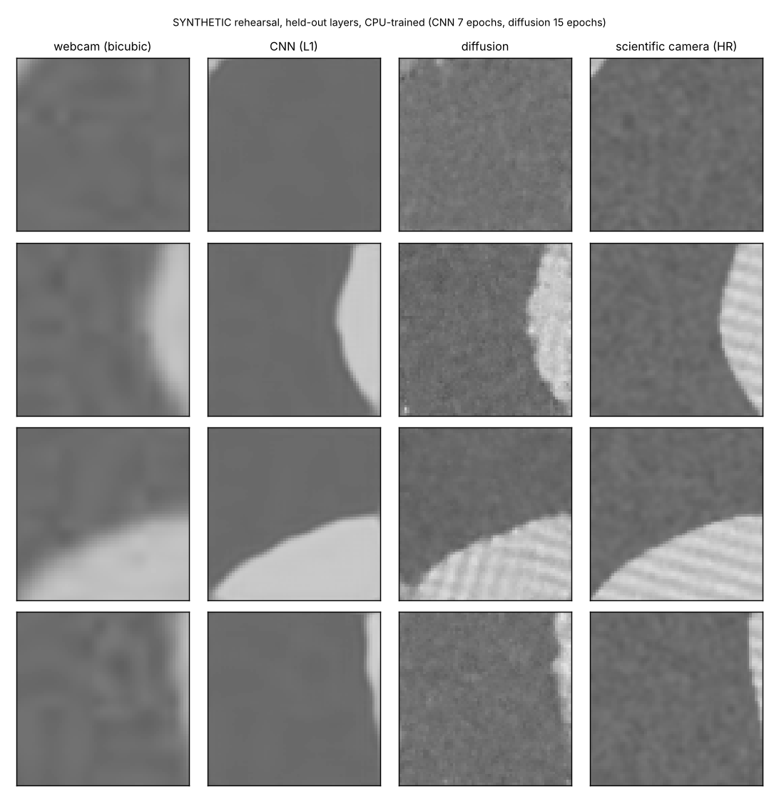

# Tutorial: diffusion super-resolution of L-PBF layer images (webcam → scientific camera)

**Skill:** [`lpbf-superres`](https://github.com/BaratiLab/mechanical-engineering-skills/tree/main/skills/lpbf-superres) · **Paper:** F. Ogoke, S. Kalambettu Suresh, J. Adamczyk, D. Bolintineanu, A. Garland, M. Heiden, A. Barati Farimani, *Deep learning based optical image super-resolution via generative diffusion models for layerwise in-situ LPBF monitoring*, Additive Manufacturing 107 (2025) 104790, [doi:10.1016/j.addma.2025.104790](https://doi.org/10.1016/j.addma.2025.104790)

Layer-wise photos of the powder bed reveal defects, but cameras sharp enough to resolve scan tracks
and edge roughness are expensive and produce a lot of data. The paper mounted a 1080p webcam next
to a scientific camera on a ProX DMP200. It trained a **conditional latent diffusion model** to
turn webcam views into scientific-camera views, reaching 30.2 dB PSNR on patches (12.3 dB for the
raw webcam) and recovering edge roughness close to the real camera's (Ra 32.8 µm vs 30.7 µm).

The paper's dataset repository is still a placeholder, so this skill ships the whole pipeline with
a synthetic ring-part build plate to rehearse on:
- registration, patches and splits;
- a conditional DDPM and a CNN baseline;
- PSNR, SSIM, MAE and a wavelet texture distance;
- part segmentation, IoU and edge Ra/Rq.

## Use cases
- **Cheap high-resolution monitoring:** one scientific camera for a calibration campaign, webcams
  on every machine afterwards.
- **Edge roughness from layer images:** Ra/Rq trends per part and per layer without sectioning.
- **Dataset building:** registration of two cameras at different angles is the hard, reusable part.
- **Teaching generative models:** the CNN-vs-diffusion comparison shows the perception–distortion
  trade-off on real engineering data.

## Setup
```bash
npx skills add BaratiLab/mechanical-engineering-skills --skill lpbf-superres
pip install numpy scipy opencv-python-headless scikit-image PyWavelets torch
cd skills/lpbf-superres
```

## 1. Register the two cameras
```bash
python scripts/sr.py synth --out plate/ --layers 20          # skip with real data: plate/hr/*.png, plate/lr/*.png
python scripts/sr.py register --hr plate/hr --lr plate/lr --out aligned/
```
How registration works, as in the paper:
1. Parts are segmented in both views and their centres matched.
2. A homography is fitted on the matched centres.
3. The remaining centre offsets are interpolated across the plate into a deformation map.

The **median centre error is 0.03 px**. Against the synthetic camera's true warp, the registered HR
image differs by 0.0014 MAE, compared with 0.083 before registration. Check this number on real
data before training.

## 2. Patches and training
```bash
python scripts/sr.py patches --aligned aligned/ --out pairs.npz          # 64x64, 115/layer, 20% of layers held out
python scripts/sr.py train --pairs pairs.npz --model cnn --out cnn.pt --lr 1e-3 --max-minutes 6
python scripts/sr.py train --pairs pairs.npz --model diffusion --out diff.pt --lr 5e-4 --max-minutes 16
python scripts/sr.py predict --model diff.pt --pairs pairs.npz --out pred_diff.npz --steps 50
python scripts/sr.py metrics --pred pred_diff.npz
```


Results on 460 held-out patches (CPU only: CNN 7 epochs, diffusion 15 epochs):

| Compared with HR | PSNR | SSIM | MAE | Wavelet texture distance ↓ |
|---|---|---|---|---|
| Webcam (bicubic) | 27.3 dB | 0.65 | 0.033 | 1.49 |
| CNN (L1) | **31.5 dB** | **0.72** | **0.021** | 4.85 |
| Diffusion | 26.4 dB | 0.59 | 0.036 | **0.65** |

The CNN wins every pixel metric by predicting the *average* plausible image: no scan tracks, no
powder. The diffusion model *samples* an image, so the tracks come back, even in the right
orientation in row 3, and its texture distance is less than half the webcam's. That gap is the
paper's reason for a generative model. An undertrained sampler adds grain, which costs PSNR; train
for the paper's 300 epochs on a GPU before comparing with its 30.2 dB.

## 3. From pixels to parts
```bash
python scripts/sr.py plate --aligned aligned/ --px-um 10 --layers 5,9 --model diff.pt --steps 30
```

| Source | Part IoU vs HR | Edge Ra | Edge Rq |
|---|---|---|---|
| HR camera | – | 8.1 µm | 10.3 µm |
| Webcam (bicubic) | 0.981 | 7.7 µm | 9.7 µm |
| CNN | 0.983 | 7.7 µm | 9.7 µm |
| Diffusion | 0.960 | 8.9 µm | 11.2 µm |

The webcam and CNN under-read roughness (too smooth). The diffusion model lands on the rough side
of HR, which is the same direction the paper reports (32.8 µm vs 30.7 µm).

## Cautions
Super-resolved detail is a *plausible* reconstruction. Use it for monitoring trends and roughness
statistics. Confirm a specific defect at a specific location with the real camera or with CT.

Cite: Ogoke et al., *Addit. Manuf.* 107 (2025) 104790.
