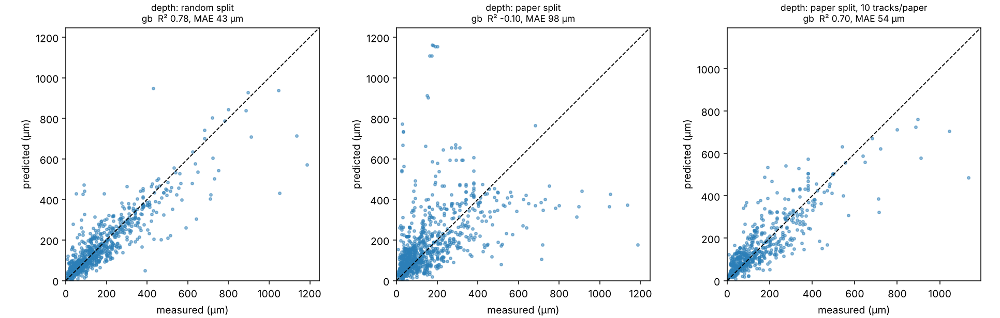

# Tutorial: MeltpoolNet (process parameters → melt-pool size and mode)

**Skill:** [`meltpool-geometry`](https://github.com/BaratiLab/mechanical-engineering-skills/tree/main/skills/meltpool-geometry) · **Paper:** P. Akbari, F. Ogoke, N.-Y. Kao, K. Meidani, C.-Y. Yeh, W. Lee, A. Barati Farimani, *MeltpoolNet: Melt pool characteristic prediction in Metal Additive Manufacturing using machine learning*, Additive Manufacturing 55 (2022) 102817, [doi:10.1016/j.addma.2022.102817](https://doi.org/10.1016/j.addma.2022.102817) · **Data:** [BaratiLab/MeltpoolNet](https://github.com/BaratiLab/MeltpoolNet)

MeltpoolNet collected melt-pool measurements from more than 80 metal AM papers: power, speed, beam
size, alloy, and the resulting depth, width, length and melt-pool mode. It benchmarks ML models with
physics-aware features and fits explicit power laws that respect dimensional analysis.

This skill gives you three estimators, from most interpretable to most data-driven:
1. Rosenthal
2. a fitted power law
3. ML models

It also tests honestly how well the ML models transfer to a machine they have never seen.

## Use cases
- **Planning single tracks:** expected depth and width before a DOE, and whether W/D is heading
  toward keyhole mode.
- **Choosing hatch and layer:** melt-pool width and depth feed the overlap criteria in
  `lpbf-defect-prediction`.
- **Teaching:** Rosenthal scaling against measured data, absorptivity models, dimensional analysis.
- **Adapting to your machine:** measure a handful of tracks, add them with `--extra`, and the model
  re-centres on your process.

## Setup
```bash
npx skills add BaratiLab/mechanical-engineering-skills --skill meltpool-geometry
pip install numpy pandas scipy scikit-learn matplotlib joblib
cd skills/meltpool-geometry
```

## 1. Physics first: Rosenthal
```bash
python scripts/meltpool.py rosenthal --material SS316L --power 200 --velocity 800
```
The result is depth 59 µm, width 118 µm and length 462 µm, with absorbed power 66 W (minimum
absorptivity 0.33 from the data). Rosenthal assumes conduction mode, so it under-predicts keyhole
depths.

## 2. An explicit formula from data
```bash
python scripts/meltpool.py identify --target depth
```
The fit is y = w0·P^a·V^b·ρ^c·Cp^d·k^e·(Tm−T0)^f with the four dimensional constraints (mass,
length, time, temperature) solved exactly; the residuals print as zeros. Result on 1,340 depth
measurements:

| Exponent | P | V | ρ | Cp | k | ΔT |
|---|---|---|---|---|---|---|
| Fitted | 0.51 | −0.22 | −0.49 | −0.63 | −0.02 | −0.64 |

The P exponent sits right at Rosenthal's ½.

| Target | Fitted power law R² | Rosenthal R², same rows |
|---|---|---|
| depth | 0.24 | strongly negative |
| width | 0.64 | strongly negative |
| length | 0.57 | strongly negative |

The paper reported 0.787, 0.991 and 0.473 for the power law. Its published equations don't
reproduce on today's public CSV under any unit convention we tried. Report what you reproduce.

## 3. ML, and the question that matters: will it transfer?
```bash
python scripts/meltpool.py benchmark --target depth --features baseline,energy --split random --models gb --plot a.png
python scripts/meltpool.py benchmark --target depth --features baseline,energy --split paper  --models gb
python scripts/meltpool.py benchmark --target depth --features baseline,energy --split paper  --models gb --calibrate 10
```


| Split | Depth R² | MAE |
|---|---|---|
| Random 5-fold, as in the paper | 0.78 | 43 µm |
| **Leave-paper-out** (whole source studies held out) | **−0.10** | 98 µm |
| Leave-paper-out + 3 of your own tracks per study | 0.52 | 71 µm |
| Leave-paper-out + 10 of your own tracks per study | 0.70 | 54 µm |

A random split shares machines, powders and measurement methods between train and test. A new
machine looks like an unseen paper. The fix is cheap: **measure a few single tracks and retrain
with `--extra`.**

Melt-pool mode classification follows the same pattern: 82.6% accuracy with a random split
(the paper reports 85.8%) and about 45% leave-paper-out.

## 4. Predict, with the caveats attached
```bash
python scripts/meltpool.py train --target depth --features baseline,energy --model gb --out depth.joblib [--extra my_tracks.csv]
python scripts/meltpool.py train --target width --features baseline,energy --model gb --out width.joblib
python scripts/meltpool.py predict --models depth.joblib,width.joblib --material Ti-6Al-4V --power 250 --velocity 1000 --beam 80
```
For Ti-6Al-4V at 250 W and 1000 mm/s, the output is:
- **depth 132 µm, width 151 µm**, so W/D = 1.15, which flags keyhole risk;
- Rosenthal: depth 61 µm, width 122 µm;
- the model's leave-paper-out validation, attached so nobody mistakes the number for a measurement.

## Notes
- `abs2` (paper Eq. 3) is computed from the **measured width**, so using it to predict geometry
  leaks the answer. The skill warns when you request it.
- The data is mostly SLM, with a little EBM, at 293 K ambient. Treat other processes and preheats
  as extrapolation.

Cite: Akbari et al., *Addit. Manuf.* 55 (2022) 102817.
