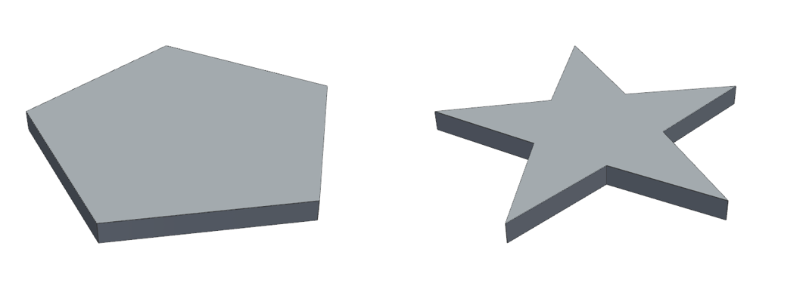

# Tutorial: Query2CAD (natural language → FreeCAD macro)

**Skill:** [`query2cad-freecad`](https://github.com/BaratiLab/me-design-skills/tree/main/skills/query2cad-freecad) · **Paper:** A. Badagabettu, S. S. Yarlagadda, A. Barati Farimani, *Query2CAD: Generating CAD models using natural language queries*, [arXiv:2406.00144](https://arxiv.org/abs/2406.00144) · **Code:** [akshay140601/Query2CAD](https://github.com/akshay140601/Query2CAD)

The LLM writes the construction steps, then a FreeCAD Python macro. Execution errors get up to 3 repairs. The model is captured from an isometric view and scored with VQAScore, P("Yes" | image, "Does this figure show {query}?"). Below 0.9, a caption of what was **actually** built is compared with the query to drive up to 3 model refinements. In the paper (GPT-4 Turbo), success rose from 53.6% to 73.2% after one refinement, and most failures were macros that never executed.

## Use cases
- **FreeCAD users** who want an editable `.FCMacro` from a description.
- **Conceptual or "named object" queries** ("a bookshelf", "a basketball hoop", "a star-shaped plate"), where meaning matters more than exact millimetres.
- **Teaching the generate-critique-refine loop.** The caption/diff step makes the model's mistakes explicit.
- **Human-in-the-loop CAD.** The user can replace the auto-caption with their own correction, which the paper found works best.

For dimension-exact parts, prefer `cadsmith-text-to-cad`.

## Setup
```bash
npx skills add BaratiLab/me-design-skills --skill query2cad-freecad
pip install pyvista trimesh matplotlib
# FreeCAD (headless): tested with FreeCAD 26.3 from conda-forge
micromamba create -p ./fc -c conda-forge freecad python=3.11
export FREECAD_CMD=$PWD/fc/bin/freecadcmd
# optional, the paper's scorer: pip install t2v-metrics   (CLIP-FlanT5-XL)
```

## Walkthrough: the paper's star-plate example, re-run in real FreeCAD
Query: **"a plate in the shape of a star"**

**v0: direct generation.** Steps: five outline points → polygon → extrude.
```bash
python scripts/q2c.py run examples/star_plate/v0.py --out runs/tut/v0
# {"ok": false, "error_type": "RuntimeError", "error": "macro produced no solid objects"}
python scripts/q2c.py log --run runs/tut --kind error --note "open outline extrudes to a shell"
# {"error_left": 2, "next": "error refinement"}
```
**v1: error refinement.** Close the polygon and make a face. It executes as a valid solid, 57.1 × 54.3 × 4 mm.
```bash
python scripts/q2c.py render runs/tut/v1.stl --out runs/tut/v1_iso.png
python scripts/q2c.py score --image runs/tut/v1_iso.png --query "a plate in the shape of a star"
```
**Caption (what's actually there):** "a flat plate with five straight sides (a regular pentagon), no pointed tips." VQA P(yes) ≈ 0.05, below 0.9, so this goes to model refinement. **Diff:** a star needs ten vertices alternating outer tips and inner notches.

**v2: model refinement.** Ten vertices at radii 30 / 12 mm. Valid solid, 12 faces, 4 mm thick. P(yes) ≈ 0.97, so the loop stops.



The ledger (`examples/star_plate/ledger.jsonl`) records each step, so you can report the refinement history the way the paper's tables do.

## Notes
- The paper drove the FreeCAD GUI with PyAutoGUI. This skill runs macros headless and renders the exported geometry, which works the same in CI and on servers.
- Without `t2v-metrics`, the agent answers the VQA question itself as a calibrated probability, and the ledger labels it `agent-judged`. Be strict; the paper counted any deviation as a failure.

## Prompts to try
- *"Make a FreeCAD macro for a bookshelf with 4 shelves, 800 mm wide."*
- *"Query2CAD: a cube of side 10 mm sitting on top of a sphere of radius 8 mm."* (the paper's medium-difficulty example)
