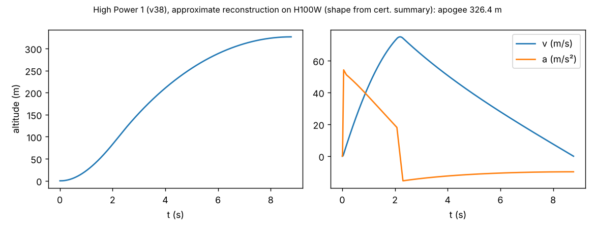
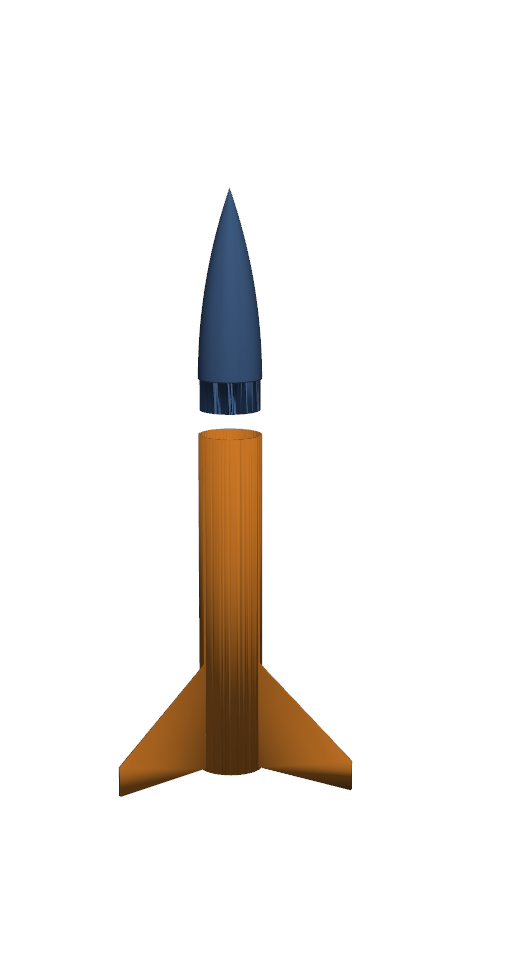

# Tutorial: RocketSmith (design, check and print a hobby high-power rocket)

**Skill:** [`rocketsmith`](https://github.com/BaratiLab/me-design-skills/tree/main/skills/rocketsmith) · **Paper:** P. Pak, J. Barkley, R. Loghmani, D. Baich, A. Pamal, A. Barati Farimani, *RocketSmith: Agentic Additive Manufacturing of High-Powered Rockets*, arXiv:2606.00097 (2026) · **Code:** [ppak10/RocketSmith](https://github.com/ppak10/RocketSmith)

RocketSmith designed four FDM-printed Class 2 rockets with OpenRocket, build123d/CADSmith and
PrusaSlicer behind an LLM agent. All four launched stably at a Tripoli Pittsburgh event. Two were
recovered reflyable, and the altimeter apogees were 80–84% of the predictions.

The paper's lesson, which RocketBench also found: **let tools compute every number** and have the
LLM orchestrate.

**Scope.** Airframes for certified commercial motors within your certification level (H–I need L1,
J–L need L2). Motor, propellant, igniter and ejection-charge design are out of scope; follow the
manufacturer and your Range Safety Officer.

## Use cases
- **Design for AM of rocket airframes:** a consolidated fin can with an integrated motor mount,
  parts sized to your printer.
- **Stability:** CG and CP at liftoff and burnout, with fins sized to a target caliber.
- **Flight prediction:** apogee, rail-exit speed, thrust-to-weight, descent rate.
- **Post-flight calibration:** fit the airframe's real drag from the altimeter.

## Setup
```bash
npx skills add BaratiLab/me-design-skills --skill rocketsmith
pip install numpy matplotlib cadquery
cd skills/rocketsmith
```

## 1. Check a design
`examples/hp1_v38.json` approximately reconstructs the paper's High Power 1: 850 mm long, 101.6 mm
diameter, AeroTech H100W.
```bash
python scripts/rocket.py check examples/hp1_v38.json
```
| | This skill | Paper |
|---|---|---|
| Liftoff mass | 2268 g | 2249.8 g |
| Stability, liftoff | 1.26 cal | 1.26 cal |
| Stability, burnout | 1.38 cal | – |
| Motor class | H (L1) | H (L1) |

All the checks pass.

How we got there: the first draft had 95 mm fins and stability **0.23 cal**, an error. Moving the
avionics forward and running
```bash
python scripts/rocket.py fins examples/hp1_v38.json --target 1.26 --out sized.json
```
widened the fin span to 162 mm, which is RocketSmith's *stability-analysis* skill.

## 2. Predict the flight and compare with the paper
```bash
python scripts/rocket.py simulate examples/hp1_v38.json --cd 0.45 --plot hp1.png
```


| | Apogee | Max velocity | Measured apogee |
|---|---|---|---|
| HP1, this skill | 326 m | 75.0 m/s | 276 m |
| HP1, paper's OpenRocket | 338.8 m | 76.4 m/s | |
| HP4 (J425R), this skill | 568 m | 113.7 m/s | 479 m |
| HP4, paper's OpenRocket | 570.1 m | 115.2 m/s | |

## 3. Learn from the flight
```bash
python scripts/rocket.py calibrate examples/hp1_v38.json --weighed "" --apogee 276      # Cd = 0.84
python scripts/rocket.py calibrate examples/hp4_big_heavy_2.json --weighed "" --apogee 479   # Cd = 0.76
```
The printed rockets flew with Cd ≈ 0.8, not the 0.45 that smooth airframes get. Printed surfaces,
rail buttons, open slots and weathercocking all cost altitude. Use the fitted value for the next
prediction.

## 4. Generate printable parts
```bash
python scripts/rocket.py cad examples/hp1_v38.json --out parts/
```


The output is an ogive nose cone with a shoulder, and a fin can with integrated fins and motor mount,
as STEP and STL with mass estimates.
- Add pilot holes for shear pins, heat inserts and eyebolts on request (see
  [`cadsmith-text-to-cad`](cadsmith-text-to-cad.md)).
- Print in PETG or ABS, not PLA, with 4–5 walls and 0.2 mm layers.
- Slice, weigh, and run `calibrate --weighed nose=...,fincan=...` to re-check stability with the
  real masses.

## Review checklist (from the paper's flights)
- **HP1:** the eyebolt pulled out of the printed baffle and the lower airframe split. Anchor
  recovery to the motor mount or reinforce the baffle.
- **HP2:** the recovery bay didn't separate, so it came down ballistic. Check shear-pin count and
  separation fit.
- Every design here is a candidate for **review by the certified flyer and the RSO**, never a launch
  approval.

Cite: Pak et al., arXiv:2606.00097 (2026).
