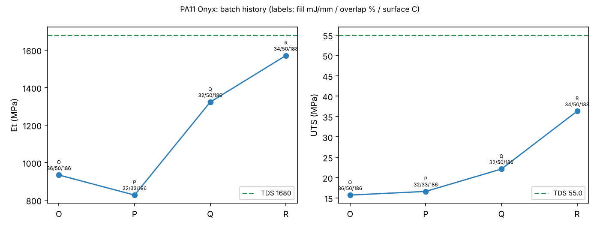

# Tutorial: agentic SLS process optimization (build history → ASTM → next batch)

**Skill:** [`sls-process-optimization`](https://github.com/BaratiLab/mechanical-engineering-skills/tree/main/skills/sls-process-optimization) · **Paper:** P. Pak, V. Alvarado, A. Barati Farimani, *AI Agentic Selective Laser Sintering Process Optimization*, arXiv:2608.25928 (2026)

On an open-source SLS4All Inova Mk1 (10 W blue diode laser), the paper's agent had three resources:
memory of every build, ASTM D638/D790 results, and tools for print profiles. Each batch, it proposed
the next fill energy density, hotspot overlap and surface temperature, and a human approved it.

- **PA11 Onyx:** tensile modulus rose from 934 to 1571 MPa over four batches. The datasheet value
  is 1680 MPa, specified for a nitrogen atmosphere the machine doesn't have.
- **PA12 blend** (25% glass-filled PA12 as an absorber in PA12 White): UTS reached 44.4 MPa in three
  batches, above the PA12 GF datasheet.

The skill keeps the paper's 21 batches as a starting history. It reduces raw test curves and
suggests bounded next steps, and the agent explains every change.

## Use cases
- **New powders on a desktop SLS:** go from "it sinters" to datasheet properties in a few batches.
- **Machine bring-up:** calibrate a new printer against reference parts.
- **Material experiments:** absorber doping, blends, recycled powder ratios.
- **Teaching:** process–property links with real ASTM data.

## Setup
```bash
npx skills add BaratiLab/mechanical-engineering-skills --skill sls-process-optimization
pip install numpy scipy scikit-learn matplotlib
cd skills/sls-process-optimization
```

## 1. Start from the lab's history
```bash
python scripts/sls.py --db builds.sqlite init --seed-paper
python scripts/sls.py --db builds.sqlite history --material "PA11 Onyx" --plot onyx.png
```


Batch scores (mean fraction of datasheet properties reached): O 0.42, P 0.36, Q 0.61, R 0.81.

## 2. Reduce the test data
```bash
python scripts/sls.py astm --test d638 --type 4 --csv t1.csv t2.csv t3.csv t4.csv t5.csv > tensile.json
python scripts/sls.py astm --test d790 --csv f1.csv f2.csv f3.csv > flex.json
python scripts/sls.py --db builds.sqlite result --batch R2 --from tensile.json
```
- D638 gives stress F/A and strain from extension/gauge; modulus is the initial slope.
- D790 gives σf = 3PL/2bd², and Ef = L³m/4bd³ with span 16d.
- The example curves in `examples/` recover E = 1500 and Ef = 1100 MPa exactly.
- The output gives mean ± sd as well as the best specimen (the paper's convention). Batch H shows
  why the scatter matters: its record result couldn't be reproduced.

## 3. Ask for the next batch, then decide
```bash
python scripts/sls.py --db builds.sqlite suggest --material "PA11 Onyx" --objective score
```
The suggester uses Gaussian-process expected improvement with these bounds:
- fill within ±8 mJ/mm of the best batch;
- overlap chosen from {25, 33, 50}%;
- surface temperature between 25 °C and 3 °C below the melt peak.

It returns ranked candidates, the levers each one changes, and the warnings from past batches (here,
batch O's warping). **The agent picks one or two levers and explains the physics**, and the user
approves before printing.

**Replay check on the manual PA12 GF history.** At each point the suggester saw only the batches up
to that point:

| Batches seen | One lever in the suggestions | What actually happened |
|---|---|---|
| A–C | Overlap 25 → 50% | Batch D also moved to 50% overlap |
| A–E | Fill 28 mJ/mm | Used later, in batch I (not the next batch, F) |
| A–G | Fill 30 mJ/mm | Between I and J, the best reproducible region |

Read this as **directional agreement on single levers, not reproduction of the operators' choices.**
Over 11 chronological decisions (A–C through A–M), none of the top-3 suggestions matched the next
batch on all three settings (fill, overlap and surface temperature). The replay is also
retrospective: suggested batches that were never printed have no outcome, so it can't show that
following the suggester would have been better. Use it to propose the next step, and judge that
step by the printed result.

## Rules
- Datasheet targets assume the manufacturer's machine and atmosphere. Say when a target can't be
  reached on your setup.
- `batch` refuses a surface temperature within 3 °C of the melt peak, to avoid caking the bed.

Cite: Pak, Alvarado & Barati Farimani, arXiv:2608.25928 (2026).
