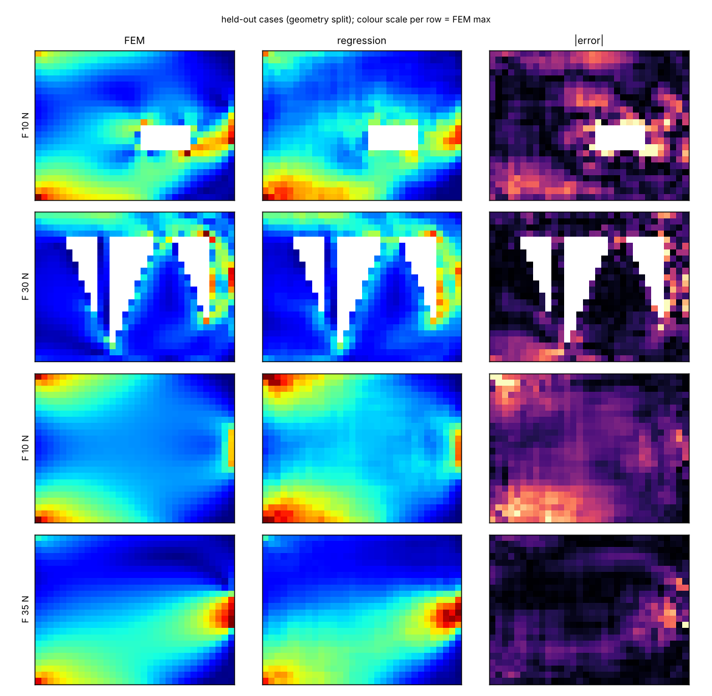

# Tutorial: StressD (geometry + loads → von Mises field, instantly)

**Skill:** [`stress-field-surrogate`](https://github.com/BaratiLab/mechanical-engineering-skills/tree/main/skills/stress-field-surrogate) · **Paper:** Y. Jadhav, J. Berthel, C. Hu, R. Panat, J. Beuth, A. Barati Farimani, *StressD: 2D stress estimation using denoising diffusion model*, Computer Methods in Applied Mechanics and Engineering 416 (2023) 116343, [doi:10.1016/j.cma.2023.116343](https://doi.org/10.1016/j.cma.2023.116343)

Topology optimization and generative design ask for thousands of stress fields. StressD answers each
one in a fraction of an FEA solve. A conditional diffusion model draws the stress field normalised
per sample, and a vision-transformer side network predicts the scale. On the standard cantilever
benchmark, StressD cut MAE by about 78% compared with StressNet and StressGAN.

## Use cases
- **Screening shapes** inside a design loop, then confirming the winner with FEA.
- **Part-family surrogates:** brackets, cantilevers, lattice cells; generate data with the built-in
  FEM or your solver.
- **Teaching:** how stress concentrates around holes and notches, live.

## Setup
```bash
npx skills add BaratiLab/mechanical-engineering-skills --skill stress-field-surrogate
pip install numpy scipy matplotlib torch
cd skills/stress-field-surrogate
```

## 1. Make data you can trust
```bash
python scripts/stressd.py dataset --out cant.npz        # 80 geometries x 72 angles x 20 magnitudes = 115,200 cases, ~20 s
```
- The data mirrors the paper's cantilever set: 32 × 24 grid, left edge clamped, tip load at 0–355°
  and 5–100 N, in six geometry families.
- The plane-stress Q4 FEM matches beam theory within 1% on slender strips.
- Because the problem is linear, each geometry takes just **2 solves**.

## 2. Train and test on shapes the model has never seen
```bash
python scripts/stressd.py train --data cant.npz --model regression --out reg.pt          # baseline
python scripts/stressd.py train --data cant.npz --model diffusion  --out sd.pt           # StressD
python scripts/stressd.py predict --model sd.pt --data cant.npz --out pred.npz --steps 50
python scripts/stressd.py metrics --pred pred.npz
python scripts/stressd.py plot --pred pred.npz --out cases.png
```


Results from a CPU rehearsal (a few epochs each, 30k training cases):

| Model, split | MAE (MPa) | Peak-stress error |
|---|---|---|
| Regression, random split (the paper's protocol) | 0.57 | 11.1% |
| Regression, **unseen geometries** | 0.81 | 12.0% |
| Diffusion, unseen geometries (4 epochs) | 1.97 | 14.8% |

Mean true von Mises is about 5.5 MPa.

**Why the split matters.** The paper's 80/20 random split shares geometries between train and test.
Stress is linear in load, so a geometry the model has seen under other loads is nearly free to
predict. Shapes it has never seen, the real design use, are harder; here 0.81 against 0.57 MAE at
equal training. The skill defaults to unseen geometries.

The diffusion model needs much longer training than a CPU rehearsal: the paper reached MAE 0.04
after full GPU training. Train it to convergence before comparing.

## In a design loop
Screen hundreds of candidates with the surrogate, keep the best few, and **confirm them with real
FEA** (`quick-fea` in this library). Report peak-stress error;
surrogates err most at notches and holes. Never take a safety factor from a surrogate.

Cite: Jadhav et al., *CMAME* 416 (2023) 116343.
