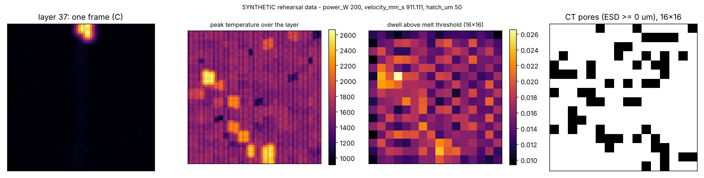

# Tutorial: ThermoPore (in-situ thermal images → layer porosity)

**Skill:** [`thermal-porosity`](https://github.com/BaratiLab/me-design-skills/tree/main/skills/thermal-porosity) · **Paper:** P. Pak, F. Ogoke, A. Polonsky, A. Garland, D.S. Bolintineanu, D.R. Moser, M. Arnhart, J. Madison, T. Ivanoff, J. Mitchell, B. Jared, B. Salzbrenner, M.J. Heiden, A. Barati Farimani, *ThermoPore: Predicting part porosity based on thermal images using deep learning*, Additive Manufacturing 95 (2024) 104503, [doi:10.1016/j.addma.2024.104503](https://doi.org/10.1016/j.addma.2024.104503)

Part qualification usually waits for CT. ThermoPore asks how much of that answer is already in the
pyrometry stream recorded while the part was built. For each 30 µm layer it pairs 200 thermal
frames (64 × 64 px at about 21 µm/px) with the CT pores in that layer, and trains two models:
- a CNN that **counts** pores (best R² 0.57, best RMSE 7.84);
- a video transformer (ViViT) that **localizes** them on a 16 × 16 grid (mean IoU 0.32).

The pyrometry and CT data are not public. The skill therefore ships the full pipeline plus a
**synthetic rehearsal build** with the same shapes, so you can check every step before your own
data arrives.

## Use cases
- **Porosity digital twin:** flag layers and regions for CT or sectioning, so the ex-situ budget
  goes where the thermal history looks wrong.
- **Process development:** correlate cold and hot cells with lack-of-fusion and keyhole pores while
  sweeping speed or hatch.
- **Data preparation:** empty-frame filtering, CT-to-thermal alignment, ESD thresholds and
  within-step splits are the tedious parts; the skill standardizes them.
- **Benchmarking:** an interpretable thermal-history baseline every deep model must beat.

## Setup
```bash
npx skills add BaratiLab/me-design-skills --skill thermal-porosity
pip install numpy pandas scikit-learn matplotlib     # + torch for the CNN / ViViT
cd skills/thermal-porosity
```

## 1. Rehearse on synthetic data
```bash
python scripts/thermopore.py synth --out run/       # 10 steps x 16 layers, speed swept 600 -> 2000 mm/s, 200 frames/layer
python scripts/thermopore.py map --data run/ --layer 37 --out l37.png
```


The map shows four panels:
1. one frame, with the melt pool mid-raster;
2. peak temperature over the whole layer, where hot and cold spots are "powder events";
3. dwell time above the melt threshold, pooled to the 16 × 16 label grid;
4. the CT pore map.

Every result from this data is marked `"synthetic_data": true`. It proves the code, not the physics.

## 2. Baseline before deep learning
```bash
python scripts/thermopore.py baseline --data run/ --task count
python scripts/thermopore.py baseline --data run/ --task localize
```
Results on the synthetic rehearsal, with the paper's 75/25 split *within* each process step
(120 train / 40 test layers):

| Model | Count R² / RMSE | Localization IoU mean / max |
|---|---|---|
| Thermal-history baseline (RF / GB on 16 × 16 peak, dwell and roughness maps) | 0.44 / 10.1 | 0.27 / 0.33 |
| CNN, paper architecture, `--small`, 150 epochs on CPU | 0.07 / 13.0 | – |
| ViViT, `--small`, 40 epochs on CPU | – | 0.24 / 0.31 |
| *Paper, real data (CNN / ViViT)* | *0.57 / 7.84* | *0.32 / 1.0* |

With about 120 training layers, the explainable baseline holds its own. The deep models need the
paper's 500 / 1000 epochs and a GPU, and they pay off as data grows.

## 3. Your own build
```bash
python scripts/thermopore.py prepare --frames layers/ --pores ct_pores.csv --out run/ \
    --z-offset 5 --xy-offset 120,40 --voxel-um 3.63
python scripts/thermopore.py map --data run/ --layer 60 --out check.png       # alignment check first
python scripts/thermopore.py baseline --data run/ --task count --depth 2 --esd-min musigma
python scripts/thermopore.py train --data run/ --task localize --epochs 1000 --rotate --out vivit.pt
```
- `layers/` holds one `.npy` or `.tif` stack per layer. Empty frames are removed by a peak-temperature
  threshold, then each layer is resampled to 200 frames.
- `ct_pores.csv` has a pore id, a layer (or z), x/y in µm, and ESD (or voxel count).
- `--depth 2` counts pores up to one layer below. The paper found this helps where keyhole pores
  sit beneath the layer that made them.
- `--esd-min musigma` keeps pores above mean + 1 σ ESD (about 50 µm in the paper). Fewer, more
  meaningful pores, but noisier IoU.

## Reading the results
Report RMSE and R² on rounded counts, and IoU at a threshold chosen on the training layers.
Always show the baseline alongside the deep model. These models choose *where to look*; CT still
decides whether a part passes.

Cite: Pak et al., *Addit. Manuf.* 95 (2024) 104503.
